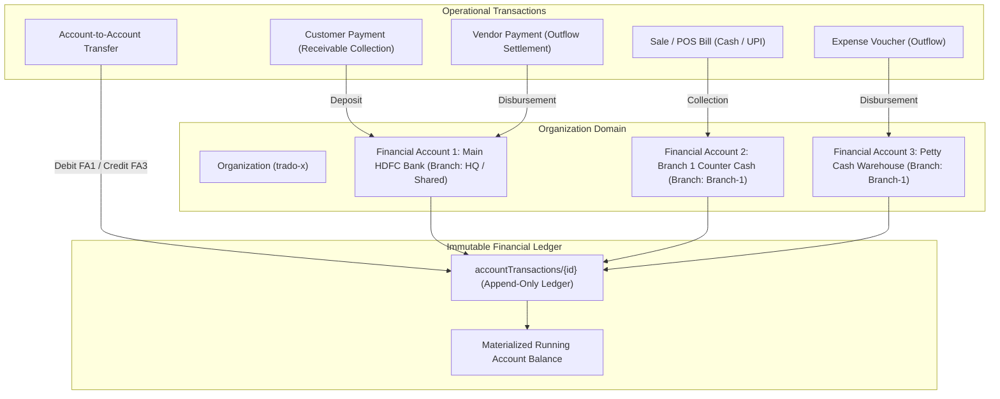
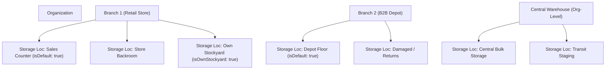
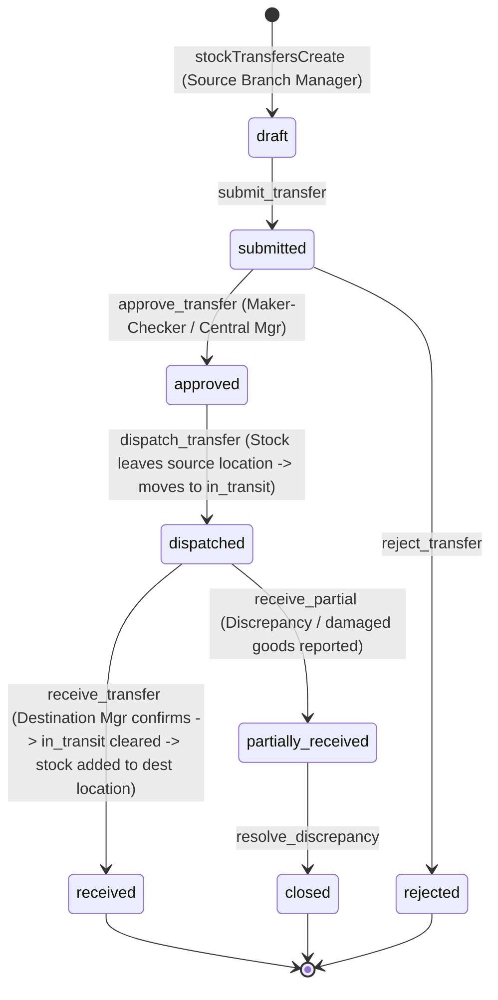

# Master Forensic Audit & Architecture Blueprint: Financial Accounting, Multi-Branch Operations, Warehouses, Stock Transfers & Approvals

- **Document ID:** `AUDIT-2026-11-16-FIN-BRANCH-INV`
- **Auditor:** Antigravity (Google DeepMind)
- **Target Repository:** `BACKEND_REPO` (`C:\Users\jesil.p\Project\FireBase\trado-firebase`; Firebase project `trado-x`)
- **Reference Repository:** `FLUTTER_REPO` (`C:\Users\jesil.p\Project\Flutter\pmj-samples\testing-trado`; read-only)
- **Date:** 2026-11-16
- **Status:** PHASE 0 COMPLETE — FORENSIC AUDIT & ARCHITECTURAL BLUEPRINT (Code modifications held until approval)

---

## 1. Executive Reconciliation of Audit Inconsistencies

Prior audit summaries cited conflicting metrics across the two repositories. A forensic scan of the current codebases reconciles every discrepancy:

| Metric Category | Claim A | Claim B | Forensic Truth & Root Cause |
|---|---|---|---|
| **Contract Entities & Fields** | 23 entities / 543 fields | 39 entities / 621 fields | **Reconciled:** 23 entities / 543 fields represent the *base operational ERP entities* (bills, branches, customers, products, outflows, etc.). 39 entities / 621 fields represent the *full expanded set*, which includes the base entities plus `request` (20 fields) and its 15 static category detail sub-schemas (58 fields total). Both figures are accurate depending on whether category sub-forms are counted as distinct entities. |
| **Callable Functions** | 104 referenced callables | 134 coupled callables | **Reconciled:** The backend exports **150 HTTPS callables** in `functions/src/index.ts`. Of these, **134 callables** belong to core tenant domain collections coupled to OpenAPI manifests and test suites in `scripts/verify-coupling.js`. The Flutter client references **106 callables** in `FLUTTER_REPO/tool/alignment/callables.md` (previously 104 before the 2 recent request desk callables were wired). The remaining backend callables are administrative, seed, or background utilities. |
| **Permissions Count** | 129 backend permissions | 124 Flutter permissions | **Reconciled:** The backend permissions catalog declares **129 permission keys** in `functions/src/constants/permissions.ts`. Flutter declares **124 keys** in `lib/core/constants/permissions.dart`. Exactly **5 backend keys** are missing in Flutter: `audit:read_own`, `usage:read`, `usage:read_users`, `platform:requests_override_blockers`, and `platform:requests_configure`. |
| **Feature Domains** | 20 backend domains | 19 Flutter domains | **Reconciled:** The backend defines **20 architectural domains**. In Flutter, **19 domains** have active UI screens. The 20th domain, *Live Location Tracking* (`locationsRecordPing`, `locationsGetLatest`), currently has no dedicated UI screen in Flutter and is intentionally **DEFERRED (FB-6)**. |
| **Test Cases Matrix** | 286 unit/widget tests, 90 sweep tests | 3,552 theoretical matrix | **Reconciled:** 3,552 is the **theoretical Cartesian product** (74 routes × 8 personas × 3 viewports × 2 text scales = 3,552 cases) defined in `numbers.md`. It was never claimed as executed. The actual test execution consists of **294 concrete tests** (286 feature unit/widget tests + 8 test tools) and **90 route-sweep cases** in `test/app/route_sweep_test.dart`. |

---

## 2. Forensic Inventory of Existing Backend Systems

### 2.1 Concrete Collections & Subcollections (52 Total)
- **Tenant & RBAC (10):** `organizations`, `organizations/{id}/branches/{id}`, `memberships`, `membershipBranches`, `roles`, `departments`, `jobRoles`, `teams`, `subscriptionPlans`, `permissionCatalog`.
- **Operations & Transactions (7):** `bills`, `outflows`, `payments`, `deliveries`, `returns`, `recurringExpenses`, `tasks`.
- **Parties & Ledgers (2):** `customers`, `vendors`.
- **Catalog & Inventory (8):** `products`, `categories`, `units`, `serials`, `stockMovements`, `stockBalances`, `stockAdjustmentRequests`, `branchProductStock`.
- **Support & Requests Desk (2):** `requests`, `requests/{requestId}/activity/{activityId}`.
- **Analytics & Usage Metering (10):** `dailySummaries`, `monthlySummaries`, `organizationUsageDaily`, `organizationUsageMonthly`, `branchUsageDaily`, `branchUsageMonthly`, `usageRateCards`, `usageCounterShards`, `platformCostReconciliation`, `platformSettings`.
- **System Infrastructure (10):** `auditLogs`, `documentCounters`, `counters`, `idempotencyRecords`, `imageUploadSessions`, `users`, `users/{uid}/devices/{deviceId}`, `notificationOutbox`, `notifications`, `uniqueKeys`.
- **Tasks & Location (3):** `tasks`, `locationPings`, `latestLocations`.

### 2.2 Existing Financial Account & Payment Implementation (Current vs Gap)
- **Current Model:**
  - `PaymentDoc` (`payments/{paymentId}`) exists and records flat cash flow: `amount`, `direction` ("in" | "out"), `partyType` ("customer" | "vendor"), `method` ("cash" | "bank_transfer" | "card" | "upi" | "cheque"), `referenceId` (billId or outflowId).
  - `OrganizationDoc.bankAccounts?: BankAccountRecord[]` stores static metadata for invoices and compliance (account holder, bank name, IFSC/SWIFT, account number, UPI ID).
- **Critical Findings & Gaps:**
  1. **No Operational Financial Account Entity:** There is no `financialAccounts` collection. Accounts such as "Main Cash", "Branch 1 Petty Cash", "HDFC Current Account", or "Payment Gateway Clearing" do not exist as operational ledger entities.
  2. **No Financial Account Linking:** `PaymentDoc`, `BillDoc`, and `OutflowDoc` do not carry a `financialAccountId`. The system records the payment method string, but has no concept of *which account* held or disbursed the funds.
  3. **No Account Balances or Ledger:** There is no double-entry ledger or append-only account transaction history (`accountTransactions`). Balances for cash-in-hand, bank accounts, or digital wallets cannot be tracked, audited, or reconciled.
  4. **No Account Transfers:** There is no mechanism to transfer funds between accounts (e.g., Cash Deposit: Counter Cash -> Bank Account; Petty Cash replenishment: Bank -> Branch Cash).

### 2.3 Customer Receivables & Vendor Payables (Current vs Gap)
- **Current Model:**
  - `CustomerDoc.outstandingBalance` and `VendorDoc.outstandingPayable` are maintained as cached scalar balances.
  - In `billsCreate` / `billsFinalize`, `customer.outstandingBalance` is incremented by `bill.balanceAmount`.
  - In `outflowsCreate`, `vendor.outstandingPayable` is incremented by `outflow.balanceAmount`.
  - In `paymentsCreate`, `customer.outstandingBalance` or `vendor.outstandingPayable` is decremented by `payment.amount`.
- **Critical Findings & Gaps:**
  1. **Single-Document Settlement Only:** A payment can only link to *one* `referenceId` (`billId` or `outflowId`). A customer paying ₹50,000 against 3 open invoices cannot have their payment distributed.
  2. **No Unallocated Advance Payments:** A payment without a `referenceId` reduces the customer's total `outstandingBalance`, but leaves all individual invoices marked as "unpaid", leading to reconciliation drift between document balances and party balance.
  3. **No Ageing Analysis:** There is no API or ledger projection to calculate overdue ageing buckets (`0-30`, `31-60`, `61-90`, `90+` days) based on invoice due dates.
  4. **No Customer/Vendor Statement API with Running Balances:** `reportsGetPartyStatement` exists but merely queries past bills and payments on the fly without a verified running balance or branch-scoped filtering.

### 2.4 Branch, Warehouse & Storage Location Management (Current vs Gap)
- **Current Model:**
  - `BranchDoc` (`organizations/{orgId}/branches/{branchId}`) exists with `code`, `name`, `address`, `contact`, and `settings` (`allowNegativeStock`, `defaultSalesMode`, `moduleOverrides`).
  - Stock is tracked at the branch level in `branchProductStock` (`{orgId}_{branchId}_{productId}`).
- **Critical Findings & Gaps:**
  1. **No Storage Location / Warehouse Hierarchy:** There is no concept of warehouses, stockyards, sales counters, transit locations, or damaged-goods rooms. A branch is treated as a monolithic location.
  2. **Branch Own-Stockyard Unmodeled:** There is no attribute or relationship modeling whether a branch owns its own stockyard/warehouse or draws stock from a central facility.
  3. **No Inter-Branch Stock Transfers:** There is no `stockTransfers` collection. Moving 30 units of Product X from Branch A to Branch B cannot be performed as a traceable workflow. Currently, users would have to manually create an adjustment-out in Branch A and an adjustment-in in Branch B, losing the link, audit trail, transit state, and approver identity.

### 2.5 Approval & Maker-Checker Workflows (Current vs Gap)
- **Current Model:**
  - `documentsDecide` (`functions/src/callables/approvals.ts`) exists as a decision execution endpoint for `bill`, `outflow`, `return`, and `stock_adjustment`.
  - Enforces `assertCanDecide` (no self-approval) and routes to domain decision handlers.
- **Critical Findings & Gaps:**
  1. **No Approvals Queue / Inbox:** There is no callable (`approvalsList` or `approvalsInbox`) for a manager to query documents waiting for their approval across their branch or organization.
  2. **Approvals Missing for Financial Operations:** Account transfers, manual ledger adjustments, high-value refunds, and stock transfers have no maker-checker integration.

---

## 3. Comprehensive Master Gap Register

| Gap ID | Module & Area | Existing Source Location | Existing Behavior | Expected Architecture & Behavior | Proposed Solution & Required Changes | Flutter & Contract Impact |
|---|---|---|---|---|---|---|
| **GAP-FIN-01** | Financial Accounts | `functions/src/types/models.ts:176` | Static `bankAccounts[]` array on `OrganizationDoc` storing invoice metadata. No balance tracking. | Dedicated `financialAccounts` collection (`financialAccounts/{id}`) with account types (cash, bank, digital, control), branch association, opening balance, and live balance. | Add `FinancialAccountDoc` model, `FinancialAccountType` enum, Zod schemas, and CRUD callables (`financialAccountsCreate`, `financialAccountsUpdate`, `financialAccountsList`, `financialAccountsGet`). | Generates `forms/financial_account.json` and new Finance screens. |
| **GAP-FIN-02** | Financial Ledger | `functions/src/callables/payments.ts` | Payments record `amount` and `method` string, but write no double-entry or account ledger entry. | Append-only ledger `accountTransactions/{id}` recording every financial debit and credit with source references and running account balances. | Create `AccountTransactionDoc` model, transaction writer in `services/ledgerService.ts`, and `financialAccountsGetLedger` callable. | Enables real-time Cash-in-Hand, Bank Book, and Account Statement screens. |
| **GAP-FIN-03** | Account Transfers | None | No mechanism exists to transfer funds between financial accounts. | Traceable account transfer workflow with optional maker-checker approval for cash deposits, bank transfers, and petty cash top-ups. | Implement `accountTransfersCreate`, `accountTransfersList`, and `accountTransfersApprove` callables creating linked debit/credit ledger records. | Enables Account Transfer UI in Finance module. |
| **GAP-FIN-04** | Payment Allocations | `functions/src/callables/payments.ts:133-141` | Payments link to exactly one `billId` or `outflowId` via `referenceId`. Multi-invoice settlement fails. | Support payment allocation across multiple invoices, partial allocations, and unallocated advance payments (`paymentAllocations` subcollection or ledger). | Update `CreatePaymentSchema` to accept `allocations: [{ documentId, amount }]`, update `paymentsCreate` to allocate transactionally. | Updates Payment Form in Flutter to allow multi-bill selection. |
| **GAP-FIN-05** | Ageing Reports | None | No ageing calculations exist. Outstandings are only known as aggregate totals. | Real-time receivables and payables ageing analysis in standard buckets (Current, 1–30, 31–60, 61–90, 90+ days) based on invoice due dates. | Implement `reportsGetReceivablesAgeing` and `reportsGetPayablesAgeing` callables with branch and date filtering. | Supplies Ageing Summary widgets on Finance Dashboard. |
| **GAP-FIN-06** | Bank Reconciliation | None | No reconciliation workflow exists. | Monthly/periodic statement reconciliation tracking statement balance vs ledger balance, reconciled status, and adjustments. | Implement `accountReconciliations` collection and `financialAccountsReconcile` callable. Never overwrite ledger balances directly. | Adds Reconciliation tab to Account Details screen. |
| **GAP-INV-01** | Storage Locations | None | Stock is tracked only at branch level (`branchProductStock`). No warehouse or yard distinction. | `storageLocations/{id}` collection supporting branch-owned yards, central warehouses, sales counters, and transit locations. | Implement `StorageLocationDoc` model, `storageLocationsCreate`, `storageLocationsUpdate`, `storageLocationsList`, and assign locations to branches. | Enables Warehouse & Storage Location management screens. |
| **GAP-INV-02** | Location-Aware Stock | `functions/src/types/models.ts:1160` | Stock balances and movements do not specify storage location. | Location-level stock balance `locationProductStock/{locId_prodId}` and `storageLocationId` attribute on every `StockMovementDoc`. | Add `storageLocationId` to `StockMovementDoc`, create location-level stock balance records, and enforce valid location on stock additions. | Location selector on Sales Desk, Purchase Form, and Stock Adjustment. |
| **GAP-INV-03** | Stock Transfers | `functions/src/constants/enums.ts:109` | Enum has generic `TRANSFER`, but no collection, workflow, dispatch, or receipt logic exists. | Complete inter-branch transfer lifecycle (`stockTransfers/{id}`): draft -> submitted -> approved -> dispatched (in-transit stock) -> received / rejected. | Implement `stockTransfersCreate`, `stockTransfersDispatch`, `stockTransfersReceive`, `stockTransfersList`, and atomic inventory movements. | Adds Inter-Branch Stock Transfer screen and dispatch/receive flows. |
| **GAP-APP-01** | Approvals Inbox | `functions/src/callables/approvals.ts` | `documentsDecide` allows deciding on a document by ID, but approvers have no query endpoint to list pending documents. | Unified approval inbox querying all documents in `pending_approval` across bill, outflow, return, stock adjustment, and transfer domains. | Implement `approvalsList` and `approvalsCounts` callables with branch, documentType, and date filters. | Powers the dedicated Approvals Screen (`/approvals`). |
| **GAP-ORG-01** | Org Field Permissions (FB-2) | `functions/src/callables/organizations.ts:75` | `ORGANIZATION_FIELD_POLICY.admin` is empty (`new Set()`). Admins with `org:update` fail on save with `FIELD_NOT_EDITABLE`. | Authorized non-owner users with `org:update` can edit non-sensitive organization details, while sensitive fields remain Super Admin only. | Update `ORGANIZATION_FIELD_POLICY.admin` to permit non-sensitive fields (`legalName`, `taxId`, `website`, `contact`, `addresses`). | Unblocks Admin editing in `OrganizationFormScreen`. |
| **GAP-ORG-02** | Super-Admin Fields (FB-4) | `functions/src/callables/organizations.ts:67-70` | `financialYearStartMonth`, `moduleToggles`, and `showCostToTenant` are protected server-side, but missing in Flutter form contracts. | Complete contract alignment for Super Admin organization management screens. | Synchronize Flutter forms with Super Admin field definitions. | Full parity in Organization Wizard and Super Admin screens. |
| **GAP-SEC-01** | Missing Permissions (FB-3) | `functions/src/constants/permissions.ts` | 5 permissions present in backend or needed for new financial/warehouse operations are missing in Flutter. | Exact 1-to-1 permission key parity across backend and Flutter constants. | Register missing permissions in backend `permissionsCatalog` and export to `docs/flutter-contract/permissions.md`. | Flutter adds missing constants to `permissions.dart`. |

---

## 4. Architectural Blueprints for Implementation

### 4.1 Financial Accounting & Ledger Architecture



#### Key Financial Architecture Rules:
1. **One Account Truth (R1/R4):** Account balances are never arbitrary numbers; every balance change is backed by an immutable `accountTransactions` ledger record.
2. **Branch Association:** Financial accounts carry `branchId` (or `null` for organization-wide shared accounts). Users restricted to Branch A cannot view or disburse from Branch B's accounts.
3. **Canonical Balance Calculation:** The displayed balance of an account equals:
   $$\text{Current Balance} = \text{Opening Balance} + \sum \text{Credits} - \sum \text{Debits}$$
4. **Distinction from Identity Metadata (FB-5):** `organization.bankAccounts[]` remains the legal/invoice display record for invoice headers. `financialAccounts` are operational ledger accounts used for transactions.

---

### 4.2 Multi-Branch, Warehouse & Storage Location Hierarchy



#### Storage Location Schema Properties:
- `locationId`: Unique ID (`loc_...`).
- `organizationId`: Tenant ID.
- `branchId`: Associated branch ID (nullable for central warehouses).
- `name`: Display name (e.g. "Counter Cash Storage", "Main Yard").
- `code`: Normalized code (e.g. "MAIN-YARD").
- `type`: `warehouse` | `stockyard` | `counter` | `backroom` | `quarantine` | `transit`.
- `isDefault`: Whether new sales/purchases default to this location.
- `isActive`: Operational status.

---

### 4.3 Inter-Branch Stock Transfer Lifecycle



#### Stock Transfer Invariant Guarantees:
1. **Source Deduction at Dispatch:** Available stock at the source location decreases immediately upon dispatch.
2. **In-Transit Isolation:** Dispatched goods are held in an `in_transit` state; they do not appear in the destination's available stock until received.
3. **No Duplicate Product Creation:** Transferred products reference the canonical `productId`. Upon receipt, Branch B automatically gains a `locationProductStock` entry without duplicating product master records.
4. **Internal Transfer != External Sale:** A stock transfer does not touch revenue, receivables, payables, or sales tax accounts.

---

## 5. Controlled Phasing Strategy

To maintain complete stability and backwards compatibility, the work will be executed across the following sequential phases:

- **Phase A (Complete):** Forensic audit, inconsistency reconciliation, gap register, and architectural blueprints.
- **Phase B:** Permissions & Organization Governance (Fix FB-2, FB-3, FB-4; preserve FB-1 HOLD and FB-6 DEFERRED; document FB-5 policy).
- **Phase C:** Financial Account Foundation (Schemas, CRUD callables, immutable ledger, opening balances, branch associations).
- **Phase D:** Receivables & Payables Engine (Payment allocation across multiple bills/outflows, advance payments, ageing calculations).
- **Phase E:** Branch Management Enhancements (Branch-specific transaction context, branch financial and stock summaries).
- **Phase F:** Warehouse & Storage Location Module (Storage locations, location-aware stock balances, location movement ledger).
- **Phase G:** Inter-Branch Stock Transfers (Transfer document, dispatch/in-transit/receipt lifecycle, transaction atomicity).
- **Phase H:** Sales, Purchase, and Expense Integration (Link bills and outflows to storage locations and financial accounts).
- **Phase I:** Approvals Queue & Maker-Checker Workflows (FB-7 approval inbox callable, GAP-01..GAP-09 resolutions).
- **Phase J:** Contract Pack Generation, Documentation Updates & Verification Gate.

---

## 6. Verification Commands for User Execution

Per Section 24 of the instructions, no commands, builds, migrations, or tests will be executed automatically by the agent. The user may run the following read-only commands to verify the current repository baseline:

```powershell
# 1. Verify backend working tree and baseline status
npm --prefix functions run verify:status

# 2. Verify static coupling and OpenAPI drift
node scripts/verify-coupling.js

# 3. Check schema duplication allowlist
node scripts/check-schema-duplicates.js

# 4. Check Flutter contract pack integrity
node scripts/check-flutter-contract.js
```
