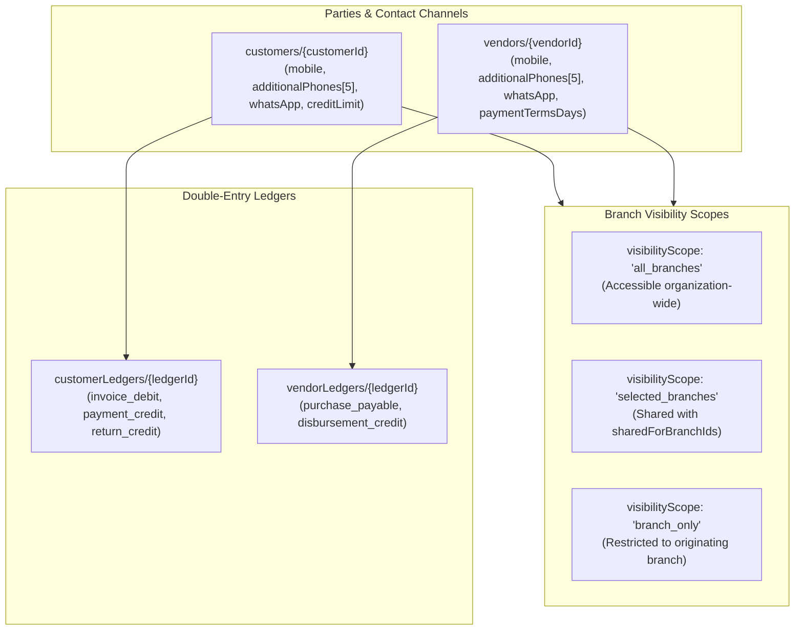
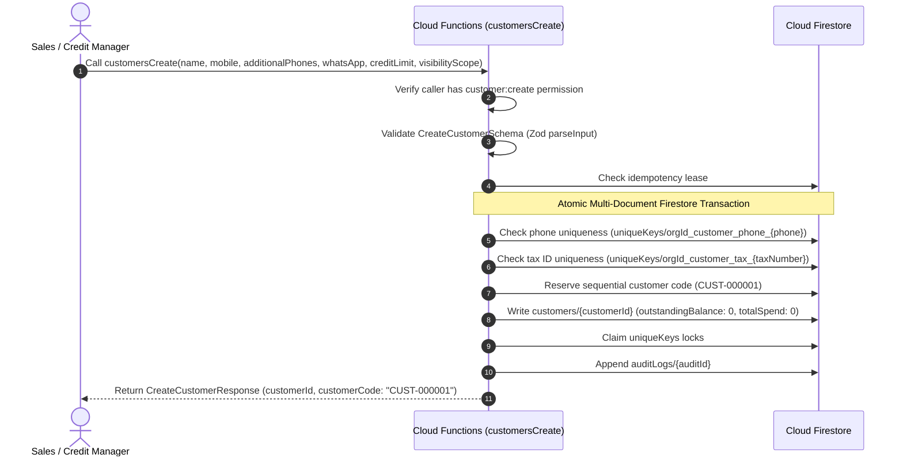

# Feature Guide: Customers & Vendors (Parties, Scopes & Ledgers)

---

## 1. Module Overview & Multi-Branch Sharing Scopes

This module manages external business counterparties (customers and suppliers), their credit limits, branch visibility rules, contact communication channels, and double-entry financial balance ledgers:
- **Customer Master (`customers/{customerId}`)**: Customer profile, credit limit, pricing group, multiple contact phone numbers, WhatsApp, and branch visibility scopes.
- **Customer Ledger (`customerLedgers/{ledgerId}`)**: Double-entry financial trail tracking debits (sales invoices) and credits (payments, returns).
- **Vendor Master (`vendors/{vendorId}`)**: Supplier profile, payment terms, multiple contact channels, and branch visibility scopes.
- **Vendor Ledger (`vendorLedgers/{ledgerId}`)**: Double-entry financial trail tracking payables (inward purchases) and disbursements (vendor payments).
- **Natural Key Deduplication (`uniqueKeys/{lockId}`)**: Uniqueness locks on phone numbers and tax identification numbers, preventing accidental duplicate party onboarding.



---

## 2. Branch Visibility Scopes & Sharing Policies

To accommodate multi-branch retailers, wholesale distributors, and franchise models, parties support granular branch visibility:

| Visibility Scope | Semantics | Operational Behavior | Target Audience |
| :--- | :--- | :--- | :--- |
| **`all_branches`** | Organization-wide access | Visible in POS billing and purchases at every branch in the tenant organization. | Corporate accounts, national wholesale suppliers. |
| **`selected_branches`** | Explicit branch sharing | Accessible only to branches listed in `sharedForBranchIds`. Other branches cannot see or bill to this party. | Regional commercial clients, local delivery hubs. |
| **`branch_only`** | Strict single-branch lock | Accessible only at the originating branch (`branchId`). Cashiers at other branches cannot query or reference this party. | Local walk-in credit accounts, neighborhood vendors. |

---

## 3. End-to-End Sequence Diagrams

### 3.1 Customer Onboarding Workflow (`customersCreate`)



---

## 4. API Reference & Parameter Specifications

### 4.1 `customersCreate`
Onboards a new customer with multi-channel contacts and credit rules.

#### Request Parameters
```typescript
interface CreateCustomerRequest {
  idempotencyKey?: string;           // 8-128 char unique lease key
  organizationId?: string;           // Optional (derived from token context)
  branchId?: string;                 // Optional (derived from token context)
  name: string;                      // 1-100 characters, customer business or individual name
  mobile?: string;                   // Primary phone (E.164 format recommended)
  additionalPhones?: string[];       // Array of up to 5 additional contact phone numbers
  whatsApp?: string | null;          // Dedicated WhatsApp phone number
  email?: string;                    // Valid email address
  taxNumber?: string;                // GSTIN / VAT / Tax ID
  billingAddress?: string;           // Max 500 characters
  shippingAddress?: string;          // Max 500 characters
  priceGroup?: string;               // "retail" | "wholesale" | "distributor"
  creditLimit?: number;              // Non-negative credit ceiling (0 = no credit)
  creditPeriodDays?: number;         // Credit settlement window (defaults to 30 days)
  visibilityScope?: "all_branches" | "selected_branches" | "branch_only";
  sharedForBranchIds?: string[];     // Array of branch IDs when visibilityScope is selected_branches
  isDefault?: boolean;               // Default walk-in customer flag
  duplicateOverrideReason?: string;  // Authorized explanation if overriding duplicate phone/tax lock
}
```

#### Success Response (200 OK)
```json
{
  "customerId": "cust_8a9b0c1d2e",
  "organizationId": "org_apex_sample",
  "customerCode": "CUST-000024",
  "name": "City Cycle Store",
  "outstandingBalance": 0.00,
  "creditLimit": 100000.00,
  "status": "active",
  "message": "Customer created successfully."
}
```

---

### 4.2 `vendorsCreate`
Onboards a supplier with procurement payment terms and tax credentials.

#### Request Parameters
```typescript
interface CreateVendorRequest {
  idempotencyKey?: string;           // 8-128 char unique lease key
  organizationId?: string;           // Optional (derived from token context)
  branchId?: string;                 // Optional (derived from token context)
  name: string;                      // 1-100 characters, vendor company name
  mobile?: string;                   // Primary vendor contact phone
  additionalPhones?: string[];       // Array of up to 5 additional phone numbers
  whatsApp?: string | null;          // Dedicated WhatsApp number
  email?: string;                    // Vendor billing/orders email
  taxNumber?: string;                // Vendor GSTIN / Tax identifier
  address?: string;                  // Physical warehouse / corporate address
  contactPerson?: string;            // Contact manager name
  paymentTermsDays?: number;         // Payment terms (e.g. Net 15, Net 30)
  creditLimit?: number;              // Vendor-extended credit limit
  visibilityScope?: "all_branches" | "selected_branches" | "branch_only";
  sharedForBranchIds?: string[];
  isDefault?: boolean;
  duplicateOverrideReason?: string;
}
```

#### Success Response (200 OK)
```json
{
  "vendorId": "vend_5f6e7d8c9b",
  "organizationId": "org_apex_sample",
  "vendorCode": "VEND-000012",
  "name": "Ludhiana Cycles Ltd",
  "outstandingPayable": 0.00,
  "status": "active",
  "message": "Vendor registered successfully."
}
```

---

## 5. Party Ledgers & Double-Entry Balance Tracking

### 5.1 Customer Balance Mechanics
$$\text{Customer Outstanding Balance} = \sum \text{Invoices} - \sum \text{Payments} - \sum \text{Returns}$$
- **Debit Entry (`invoice_debit`)**: Finalizing an invoice increases customer debt (`outstandingBalance += invoiceBalance`).
- **Credit Entry (`payment_credit`)**: Receiving payment decreases customer debt (`outstandingBalance -= paymentAmount`).
- **Credit Entry (`return_credit`)**: Approving a sales return credit note decreases customer debt.

### 5.2 Vendor Balance Mechanics
$$\text{Vendor Outstanding Payable} = \sum \text{Purchases} - \sum \text{Disbursements} - \sum \text{Vendor Returns}$$
- **Payable Entry (`purchase_payable`)**: Recording a purchase increases company debt to vendor (`outstandingPayable += purchaseBalance`).
- **Disbursement Entry (`disbursement_credit`)**: Paying vendor reduces company debt (`outstandingPayable -= paymentAmount`).

---

## 6. Manual Emulator Testing Commands

```powershell
# 1. Run Multi-Branch Party Isolation and Visibility Sharing Tests
node functions/scripts/test-e2e-multi-branch-isolation.cjs

# 2. Reconcile Customer and Vendor Ledgers against Master Balances
node functions/scripts/test-e2e-business-flow.cjs
```
