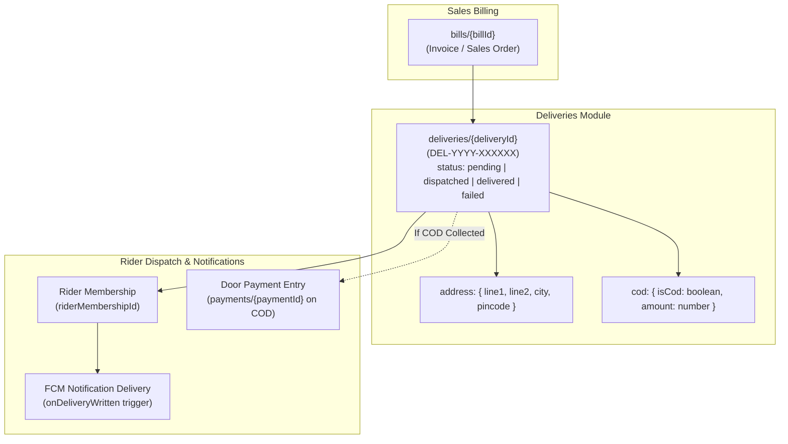
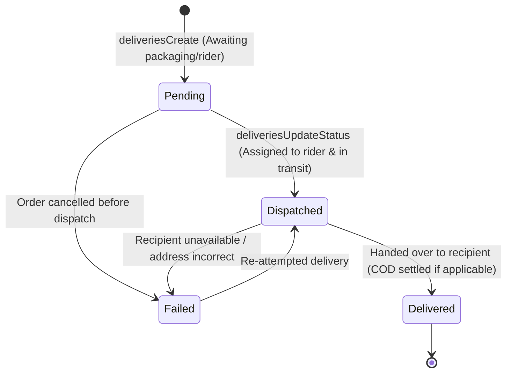
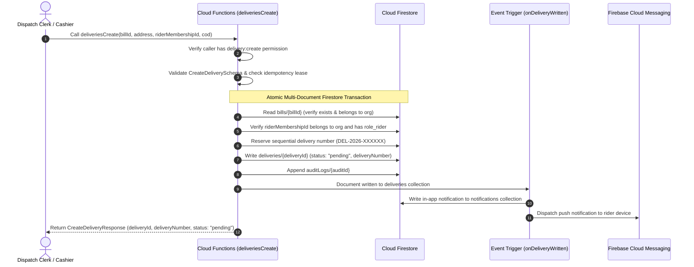

# Feature Guide: Deliveries & Dispatch Management

---

## 1. Module Overview & Fulfillment Architecture

The Deliveries module provides order fulfillment tracking, rider dispatching, Cash-on-Delivery (COD) reconciliation, and push notification triggers for Trado:
- **Delivery Master (`deliveries/{deliveryId}`)**: Manages fulfillment state, partial delivery line items, recipient contact details, physical delivery address, and rider assignment.
- **Bare Reference Architecture**: Deliveries reference their parent order via `billId` by bare ID only. The entire bill document is never embedded.
- **Partial Delivery Support**: Allows splitting an order across multiple shipments by specifying `lines: [{ lineId, quantity }]`.
- **Cash-on-Delivery (COD) Engine**: Supports door-step cash and UPI collection, automatically settling pre-sale orders and generating payment records.
- **Automated Dispatch Triggers**: Trigger `onDeliveryWritten` dispatches real-time in-app and FCM push notifications when a rider is assigned.



---

## 2. Delivery Status Lifecycle & State Machine



---

## 3. End-to-End Sequence Diagrams

### 3.1 Delivery Creation & Dispatch Flow (`deliveriesCreate`)



---

## 4. API Reference & Parameter Specifications

### 4.1 `deliveriesCreate`
Creates a delivery fulfillment record for an invoice or sales order.

#### Request Parameters
```typescript
interface CreateDeliveryRequest {
  idempotencyKey?: string;           // 8-128 char unique lease key
  organizationId?: string;           // Optional (derived from token context)
  branchId?: string;                 // Optional (derived from token context)
  billId: string;                    // Target bill / order ID
  lines?: Array<{                    // Optional partial line item fulfillment
    lineId: string;
    quantity: number;
  }>;
  recipient?: {                      // Person receiving package (if different from bill-to party)
    name: string;
    phone: string;
  };
  address: {                         // Physical delivery address
    line1: string;
    line2?: string;
    landmark?: string;
    city: string;
    pincode: string;
  };
  riderMembershipId?: string | null; // Assigned delivery rider membership ID
  partner?: "internal" | "dunzo" | "shadowfax" | "other"; // Default: "internal"
  deliveryFee?: number;              // Extra shipping/delivery charge (default: 0)
  cod?: {                            // Cash-on-Delivery specifications
    isCod: boolean;
    amount: number;
  };
  notes?: string;                    // Delivery instructions
}
```

#### Success Response (200 OK)
```json
{
  "deliveryId": "del_1a2b3c4d5e",
  "organizationId": "org_apex_sample",
  "deliveryNumber": "DEL-2026-000031",
  "status": "pending",
  "billId": "bill_6a7b8c9d0e",
  "partner": "internal",
  "message": "Delivery scheduled successfully."
}
```

---

### 4.2 `deliveriesUpdateStatus`
Updates transit progression, door-step COD collection, and final completion.

#### Request Parameters
```typescript
interface UpdateDeliveryStatusRequest {
  deliveryId: string;                // Target delivery ID
  status: "pending" | "dispatched" | "delivered" | "failed";
  riderMembershipId?: string;        // Optional reassignment
  codCollected?: boolean;            // True if cash/UPI was collected at the door
  collectedAmount?: number;          // Exact monetary amount collected
  paymentMethod?: PaymentMethod;     // "cash" | "upi"
  notes?: string;                    // Delivery feedback / failure reason
}
```

#### Success Response (200 OK)
```json
{
  "deliveryId": "del_1a2b3c4d5e",
  "status": "delivered",
  "codCollected": true,
  "collectedAmount": 1450.00,
  "completedAt": "2026-11-08T18:15:00.000Z",
  "message": "Delivery status updated to delivered."
}
```

---

## 5. Manual Emulator Testing Commands

```powershell
# 1. Run Schema and Validation tests for Deliveries
node functions/scripts/test-callable-schemas.cjs

# 2. Run Delivery Event Trigger and Notification tests
node functions/scripts/test-event-triggers.cjs
```
