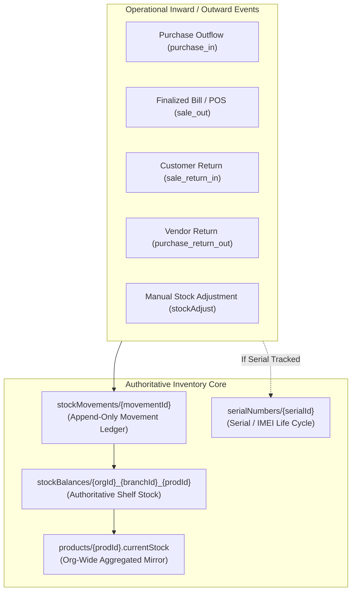
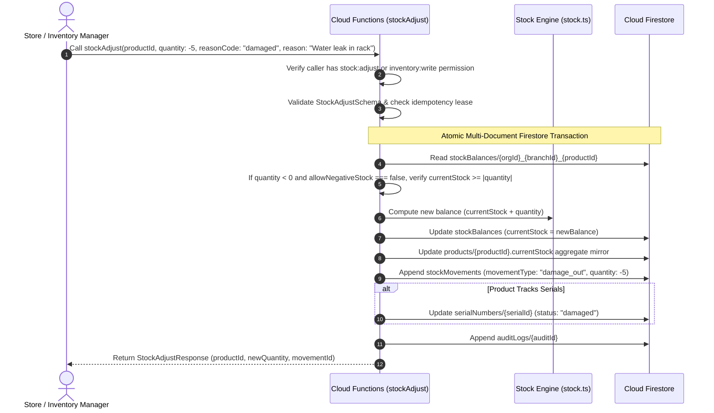

# Feature Guide: Inventory, Stock & Costing Engine

---

## 1. Module Overview & Stock Architecture

The Inventory Engine provides multi-branch physical stock tracking, serialized inventory lifecycle, double-entry audit ledgers, and real-time inventory valuation for Trado:
- **Authoritative Physical Balance (`stockBalances/{orgId}_{branchId}_{productId}`)**: The single source of truth for physical inventory at a specific branch location. Stock is never shared across branches without an explicit transfer.
- **Aggregate Mirror (`products/{productId}.currentStock`)**: Read-optimized cached total representing organization-wide stock across all branches for quick catalog display.
- **Immutable Stock Movement Ledger (`stockMovements/{movementId}`)**: Every addition, deduction, sale, return, damage, or adjustment creates a permanent, append-only movement entry.
- **Serialized Asset Tracking (`serialNumbers/{serialId}`)**: Tracks individual items (e.g. bicycle frames, mobile phones, equipment) by serial number/IMEI through their lifecycle (`in_stock`, `sold`, `returned`, `damaged`).
- **Valuation & Reconciliation Engine**: Weighted Average Cost (WAC) tracking and mathematical balance auditing (`reconcileStockBalances`).



---

## 2. Stock Movement Types & Accounting Directions

| Movement Type | Direction | Sign | Triggering API / Source | P&L / Costing Effect |
| :--- | :--- | :--- | :--- | :--- |
| **`purchase_in`** | Inward | `+` | Inward purchase confirmed (`outflowsCreate`) | Capitalized into inventory, updates WAC |
| **`sale_out`** | Outward | `-` | Bill finalized or POS checkout (`billsCreate`) | Realized as Cost of Goods Sold (COGS) |
| **`sale_return_in`** | Inward | `+` | Sales return restocked (`returnsCreate`) | Restored at historical cost or current WAC |
| **`purchase_return_out`** | Outward | `-` | Goods returned to vendor (`returnsCreate`) | Decrements vendor payable balance |
| **`adjustment_in`** | Inward | `+` | Count verification surplus (`stockAdjust`) | Inventory gain adjustment |
| **`adjustment_out`**| Outward | `-` | Count verification deficit (`stockAdjust`) | Inventory shrinkage expense |
| **`damage_out`** | Outward | `-` | Broken / spoiled items written off (`stockAdjust`) | Written off to Loss on Damaged Goods |
| **`waste_out`** | Outward | `-` | Perishable goods expired (`stockAdjust`) | Written off to Loss on Expired Inventory |

---

## 3. End-to-End Sequence Diagrams

### 3.1 Manual Stock Adjustment Workflow (`stockAdjust`)



---

## 4. API Reference & Parameter Specifications

### 4.1 `stockAdjust`
Manually adjusts stock for inventory cycle counts, damaged stock write-offs, or sample allocations.

#### Who Can Call
- Users with `stock:adjust` or `inventory:write` (e.g. `role_store_manager`, `role_admin`, `role_org_owner`).

#### Request Parameters
```typescript
interface StockAdjustRequest {
  idempotencyKey?: string;           // 8-128 char unique lease key
  organizationId?: string;           // Optional (derived from token context)
  branchId?: string;                 // Optional (derived from token context)
  productId: string;                 // Target product ID
  quantity: number;                  // Positive to add stock, negative to deduct stock
  reason: string;                    // 2-500 characters, descriptive reason
  reasonCode?: StockAdjustmentReason;// "opening_stock" | "count_verification" | "damaged" | "expired" | "lost_theft" | "sample" | "internal_use"
  serialNumbers?: string[];          // Required if product has trackSerial: true
}
```

#### Success Response (200 OK)
```json
{
  "productId": "prod_hero_sprint_26",
  "branchId": "main-branch",
  "adjustedQuantity": -2,
  "newBranchStock": 8,
  "movementId": "sm_99a8b7c6",
  "reasonCode": "damaged",
  "message": "Stock adjusted successfully."
}
```

#### Common Error Codes
- `failed-precondition`: Stock deduction would cause negative inventory when `allowNegativeStock === false`.
- `invalid-argument`: Product is serial-tracked, but serial numbers are missing or do not match quantity.
- `not-found`: Product does not exist in caller's organization.

---

### 4.2 `reconcileStockBalances`
Audits and reconciles physical stock balances against the immutable movement ledger.

#### Who Can Call
- **Platform Super Admin** or **Organization Owner** with `inventory:write`.

#### Execution Logic
- Computes mathematical ledger sum:
  $$\text{LedgerSum} = \sum \text{inward movements} - \sum \text{outward movements}$$
- Compares computed `LedgerSum` against `stockBalances.currentStock`.
- Compares sum of all branch balances against `products.currentStock`.
- Returns detailed discrepancy audit report without silently mutating records unless maintenance flag is passed.

---

## 5. Manual Emulator Testing Commands

```powershell
# 1. Run Stock Isolation and Branch Scoping Tests
node functions/scripts/test-e2e-multi-branch-isolation.cjs

# 2. Run Live Stock Movement Trigger tests
node functions/scripts/test-event-triggers.cjs

# 3. Run Two-Business Simulation (Serial tracking and damaged transit stock)
node functions/scripts/test-two-business-simulation.cjs
```
