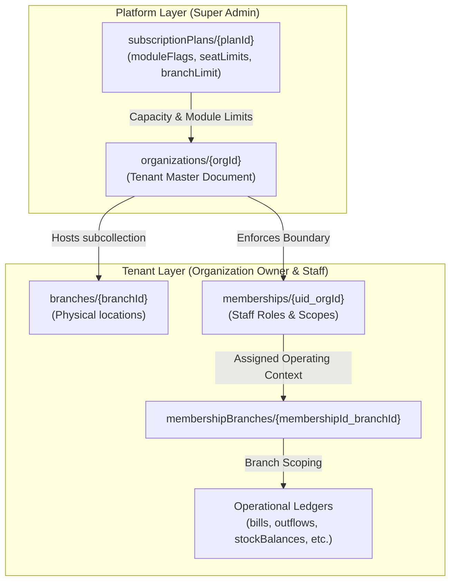
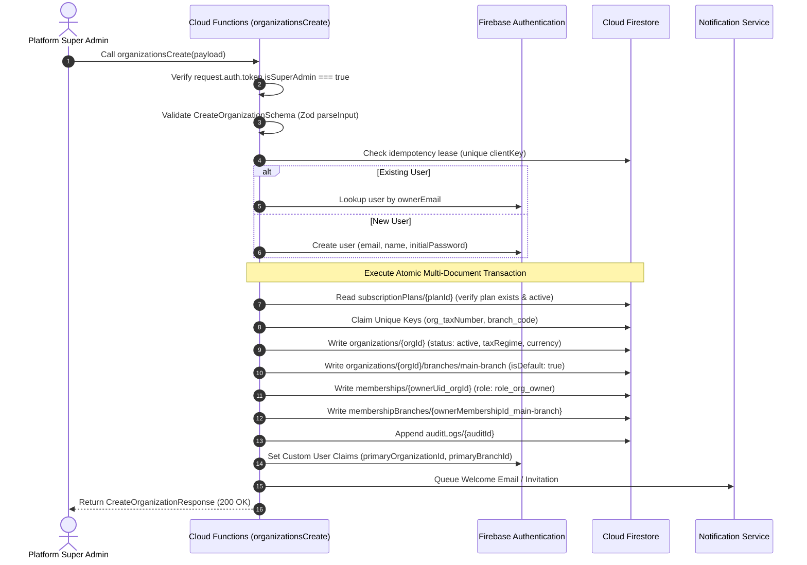
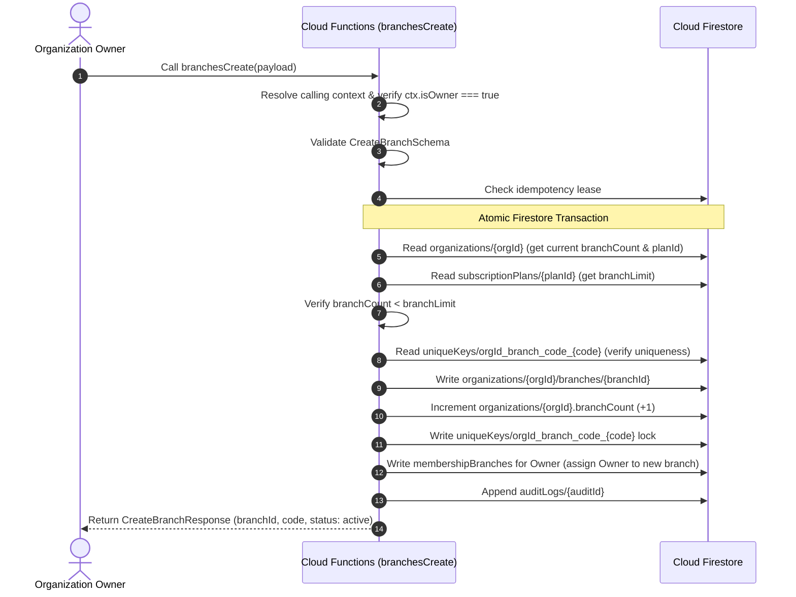

# Feature Guide: Organizations, Subscriptions & Branches

---

## 1. Module Overview & Architectural Boundaries

This module manages the fundamental multi-tenant topology of Trado:
- **Organization (`organizations/{orgId}`)**: The primary tenancy boundary. Every piece of business data—catalog items, ledgers, transactions, customers, and staff memberships—is strictly isolated within an organization.
- **Branch (`organizations/{orgId}/branches/{branchId}`)**: Operating physical location subcollection. Every organization possesses at least one default operating branch (`main-branch`).
- **Subscription Plan (`subscriptionPlans/{planId}`)**: Platform-managed tier entitlements dictating feature module flags, user seat capacity (`seatLimits`), and branch quotas (`branchLimit`).
- **Concurrency & Identity Locks (`uniqueKeys/{lockId}`)**: Strict single-source locks preventing duplicate branch codes, organization tax identifiers, or race conditions during provisioning.



---

## 2. Actors, Permissions & Platform Boundary Rules

### 2.1 Permission Matrix

| Operation | Callable Endpoint | Required Permission / Role | Permitted Actors | Platform Boundary Enforcement |
| :--- | :--- | :--- | :--- | :--- |
| **Provision Org** | `organizationsCreate` | Super Admin custom claim (`isSuperAdmin: true`) | Platform Super Admin only | Tenant users strictly denied (`PERMISSION_DENIED`) |
| **Update Org Profile** | `organizationsUpdate` | `isSuperAdmin: true` OR `isOwner` | Super Admin (entitlements), Org Owner (legal profile) | Admins/Staff strictly denied (D-07 policy) |
| **Set Subscription** | `organizationsSetSubscription` | Super Admin custom claim (`isSuperAdmin: true`) | Platform Super Admin only | Tenant users cannot self-assign subscriptions |
| **Deactivate Org** | `organizationsDeactivate` | Super Admin custom claim (`isSuperAdmin: true`) | Platform Super Admin only | Locks all tenant members out immediately |
| **List Orgs** | `organizationsList` | Super Admin custom claim (`isSuperAdmin: true`) | Platform Super Admin only | Paginated global catalog |
| **Create Branch** | `branchesCreate` | `role:write` / `isOwner` | Organization Owner | Checked against `plan.branchLimit` |
| **Update Branch** | `branchesUpdate` | `role:write` / `isOwner` | Organization Owner | Name, address, contact, settings |
| **Deactivate Branch** | `branchesDeactivate` | `role:write` / `isOwner` | Organization Owner | Cannot deactivate default `main-branch` |
| **Switch Context** | `branchContextSwitch` | Authenticated tenant member | Any active employee assigned to branch | Validates active `membershipBranches` |
| **Sharing Policies** | `sharingPoliciesUpdate` | `isOwner` | Organization Owner | Configures cross-branch data sharing |

### 2.2 Strict Platform Boundary Rule (`SUPER_ADMIN_TENANT_FORBIDDEN`)
To maintain strict multi-tenant integrity and audit compliance:
- Platform Super Admins manage global plans, provision organizations, and adjust subscription billing.
- Platform Super Admins are **strictly forbidden** from executing tenant operational mutations (`billsCreate`, `outflowsCreate`, `stockAdjust`, etc.). 
- Any attempt by a Super Admin to mutate operational records is rejected with `SUPER_ADMIN_TENANT_FORBIDDEN`.

---

## 3. End-to-End Sequence Diagrams

### 3.1 Organization Provisioning Workflow (`organizationsCreate`)



### 3.2 Branch Provisioning Workflow (`branchesCreate`)



---

## 4. API Reference & Parameter Specifications

### 4.1 `organizationsCreate`
Provisions a new tenant organization and its root owner atomically.

#### Who Can Call
- **Platform Super Admin only** (`request.auth.token.isSuperAdmin === true`).

#### Request Parameters
```typescript
interface CreateOrganizationRequest {
  idempotencyKey?: string;           // Optional 8-128 char unique lease key
  name: string;                      // 2-100 characters, business legal name
  businessType: BusinessType;        // wholesale_only | retail_only | wholesale_retail | distributor | etc.
  businessCategory: BusinessCategory;// general | grocery_supermarket | bicycle | kitchenware_household | etc.
  country: string;                   // 2-letter ISO country code (e.g. "IN", "AE", "OM", "BH", "SG", "US")
  currency: string;                  // 3-letter ISO currency code (e.g. "INR", "AED", "OMR", "BHD", "SGD", "USD")
  taxRegimeCode: string;             // "IN_GST" | "AE_VAT" | "OM_VAT" | "BH_VAT" | "SG_GST" | "US_SALES_TAX" | "NONE"
  planId: string;                    // Target plan id from subscriptionPlans collection
  ownerEmail: string;                // Valid email for organization owner
  ownerName: string;                 // 2-100 characters, owner display name
  ownerPhone?: string;               // Optional phone number (E.164 format recommended)
  initialPassword?: string;          // Optional initial password (min 8 chars); generated if omitted
  defaultBranchName?: string;        // Optional (defaults to "Main Branch")
  defaultBranchCode?: string;        // Optional alphanumeric (defaults to "MAIN")
  salesChannels?: SalesChannel[];    // Array of ["pos", "b2b", "order_taking", "ecommerce"]
  timezone?: string;                 // IANA timezone, defaults to "Asia/Kolkata"
  contacts?: OrganizationContact[];  // Optional array of contact personas (max 20)
  subscription?: {
    status?: SubscriptionStatus;     // trial | active (defaults to trial)
    startsAt?: string;               // ISO timestamp (defaults to current instant)
    expiresOn?: string;              // YYYY-MM-DD date in org timezone
    durationDays?: number;           // 1 to 3660 days (defaults to 30)
    graceDays?: number;              // 0 to 90 days (defaults to plan grace)
  };
}
```

#### Success Response (200 OK)
```json
{
  "organizationId": "org_7f8a9b2c",
  "ownerUserId": "usr_99a88b77c",
  "ownerMembershipId": "usr_99a88b77c_org_7f8a9b2c",
  "status": "active",
  "message": "Organization provisioned successfully."
}
```

#### Common Error Codes
- `unauthenticated`: Caller is not logged in.
- `permission-denied`: Caller is not a Platform Super Admin (`isSuperAdmin !== true`).
- `invalid-argument`: Validation failure (invalid email, unsupported tax regime, missing required fields).
- `not-found`: The specified `planId` does not exist in `subscriptionPlans`.
- `already-exists`: Tax number lock or idempotency collision detected.

---

### 4.2 `organizationsUpdate`
Updates legal profile, operational settings, or platform configuration.

#### Who Can Call
- **Platform Super Admin**: Allowed to edit platform attributes (`name`, `businessType`, `businessCategory`, `moduleToggles`, `salesChannels`, `timezone`).
- **Organization Owner (`role_org_owner`)**: Allowed to edit profile attributes (`displayName`, `image`, `uploadId`, `taxId`, `website`, `contact`, `contacts`, `addresses`, `bankAccounts`, `settings`).
- **Tenant Admins / Staff**: Strictly rejected with `permission-denied` (Decision D-07: Admins operate daily business but cannot mutate legal organization profile).

#### Request Parameters
```typescript
interface UpdateOrganizationRequest {
  organizationId: string;            // Target organization ID
  // Super Admin only fields:
  name?: string;
  businessType?: BusinessType;
  businessCategory?: BusinessCategory;
  moduleToggles?: Record<string, boolean>; // e.g. { billing: true, inventory: true, deliveries: false }
  salesChannels?: SalesChannel[];
  timezone?: string;
  // Owner editable fields:
  displayName?: string;
  image?: ImageRef;
  uploadId?: string;
  taxId?: string | null;             // GSTIN / TRN / VAT registration number
  website?: string | null;
  contact?: OrganizationContact;
  contacts?: OrganizationContact[];
  addresses?: Address[];
  bankAccounts?: BankAccount[];
  settings?: {
    approvals?: {
      enabled: boolean;
      modules?: {
        sale?: boolean;
        purchase?: boolean;
        expense?: boolean;
        return?: boolean;
        stock_adjustment?: boolean;
      };
      amountThreshold?: number;
    };
    businessConfig?: {
      defaultUnits?: string[];
      productFields?: Record<"expiry" | "batch" | "serial" | "variants" | "alternateUnits" | "jewellery", boolean>;
      salesMode?: SalesMode;
    };
  };
}
```

#### Success Response (200 OK)
```json
{
  "organizationId": "org_7f8a9b2c",
  "updatedFields": ["displayName", "taxId", "settings"],
  "updatedAt": "2026-11-08T18:00:00.000Z",
  "message": "Organization updated successfully."
}
```

---

### 4.3 `branchesCreate`
Creates an operating physical branch under the current tenant.

#### Who Can Call
- **Organization Owner (`role_org_owner`)** or caller with `role:write` permission.

#### Request Parameters
```typescript
interface CreateBranchRequest {
  idempotencyKey?: string;
  name: string;                      // 2-100 characters, branch name (e.g. "North Hub Warehouse")
  code: string;                      // 2-20 alphanumeric characters, uppercase (e.g. "WH-02")
  address?: {
    line1: string;
    line2?: string;
    city: string;
    state: string;
    postalCode: string;
    country: string;
  };
  contact?: {
    phone?: string | null;
    email?: string | null;
    contactPerson?: string | null;
  };
  settings?: {
    taxId?: string | null;           // Branch-specific GSTIN / tax registration
    allowNegativeStock?: boolean;    // Default: false
    defaultSalesMode?: SalesMode;    // Default: pos
    moduleOverrides?: Record<string, boolean>;
  };
}
```

#### Success Response (200 OK)
```json
{
  "branchId": "branch_8829aa1",
  "organizationId": "org_7f8a9b2c",
  "code": "WH-02",
  "name": "North Hub Warehouse",
  "isDefault": false,
  "status": "active",
  "message": "Branch created successfully."
}
```

#### Error Handling & Invariant Enforcement
- `resource-exhausted`: Reached maximum branches allowed under the subscription plan (`branchCount >= branchLimit`).
- `already-exists`: Branch code already in use within this tenant organization.

---

### 4.4 `branchContextSwitch`
Switches the caller's active operating branch context in their session claims.

#### Who Can Call
- Any authenticated employee possessing an active membership join in `membershipBranches` for the target branch, or the Organization Owner.

#### Request Parameters
```typescript
interface SwitchBranchContextRequest {
  targetBranchId: string;            // Target branch ID to activate
}
```

#### Success Response (200 OK)
```json
{
  "success": true,
  "previousBranchId": "main-branch",
  "currentBranchId": "branch_8829aa1",
  "branchName": "North Hub Warehouse",
  "branchCode": "WH-02",
  "message": "Branch context switched successfully."
}
```

---

## 5. Data Storage, Side Effects & Invariants

| Action | Primary Collections Altered | Secondary Collections / Joins | Locks & Keys Acquired | Invariant Checked |
| :--- | :--- | :--- | :--- | :--- |
| **`organizationsCreate`** | `organizations/{orgId}` | `branches/{main-branch}`, `memberships/{ownerUid_orgId}`, `membershipBranches` | `uniqueKeys/org_taxNumber`, `uniqueKeys/branch_code` | Plan exists, unique tax number, valid country/currency |
| **`organizationsUpdate`** | `organizations/{orgId}` | N/A | `auditLogs/{id}` | Strict field write policy (`ORGANIZATION_FIELD_POLICY`) |
| **`branchesCreate`** | `branches/{branchId}` | `organizations/{orgId}.branchCount` (+1), `membershipBranches` | `uniqueKeys/orgId_branch_code_{code}` | `branchCount < plan.branchLimit`, unique branch code |
| **`branchesDeactivate`**| `branches/{branchId}` | `organizations/{orgId}.branchCount` (-1) | `auditLogs/{id}` | Cannot deactivate branch if `isDefault === true` |

---

## 6. Session Organization Selection & Multi-Organization Switch (CP-4 — ON HOLD)

- **Single active membership:** `authMe` / `authLogin` automatically resolve that organization as `primaryOrganization` (`contextStatus: "active"`).
- **Multiple active memberships:** `sessionContext.ts` selects the membership marked `isPrimary: true`. If none is marked primary, `authMe` returns `contextStatus: "organization_selection_required"` with `primaryOrganization: null`, `permissions: []`, and candidate `organizations[]`.
- **No switch callable (ON HOLD):** No backend callable exists to change `isPrimary` across organizations. Both `authMe` and `authLogin` validate strict Zod schemas (`AuthMeSchema`, `AuthLoginSchema`) and **reject `requestedOrgId` with `UNKNOWN_FIELD`**. Multi-organization switching remains **ON HOLD** (frozen backend backlog item FB-1).

---

## 7. Manual Emulator Testing Commands

To test and verify organization and branch lifecycles manually against local emulators:

```powershell
# 1. Run multi-branch isolation end-to-end tests
node functions/scripts/test-e2e-multi-branch-isolation.cjs

# 2. Run flagship governance and quota denial tests
node functions/scripts/test-governance-flagship.cjs

# 3. Seed demo multi-branch environment
node functions/lib/scripts/seed-emulator.js --all --profile=multi-branch-test
```
