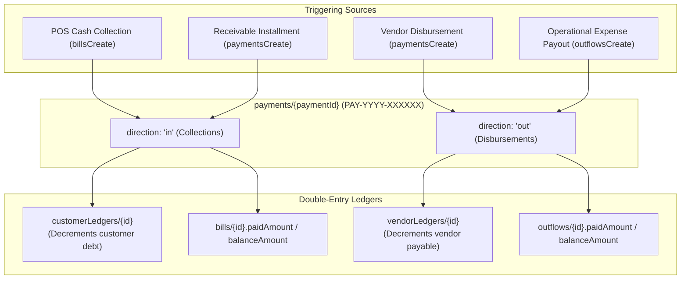
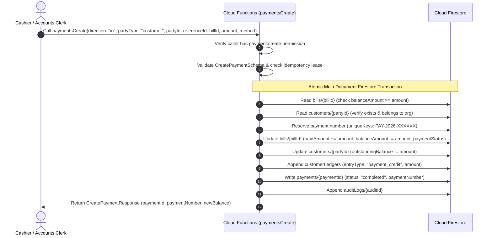
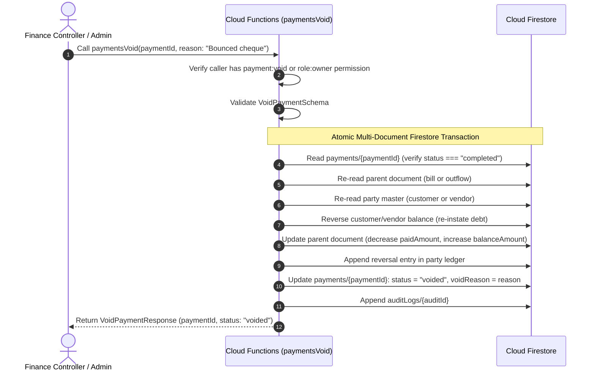

# Feature Guide: Payments & Party Ledgers

---

## 1. Module Overview & Financial Ledger Architecture

The Payments & Party Ledgers module manages financial settlements, partial debt payments, payment voiding, and double-entry reconciliation for Trado:
- **Standalone Payments Ledger (`payments/{paymentId}`)**: A dedicated, immutable log of all incoming and outgoing monetary flows. Every transaction issues an atomic sequential number (`PAY-YYYY-XXXXXX`).
- **Directional Categorization**:
  - `direction: "in"`: Incoming cash, card, UPI, or wire collections from customers.
  - `direction: "out"`: Outgoing supplier disbursements, operational expense payouts, or employee reimbursements.
- **Counterparty & Document References**: Payments link directly to parent documents (`referenceId`: `billId` or `outflowId`) and counterparty masters (`partyType`: `customer`, `vendor`, `employee`, or `other`).
- **Double-Entry Ledgers**:
  - `customerLedgers/{ledgerId}`: Debits from invoices, credits from payments and sales returns.
  - `vendorLedgers/{ledgerId}`: Credits from purchases, debits from disbursements and purchase returns.
- **Payment Voiding & Reversal (`paymentsVoid`)**: Securely cancels erroneous payments, rolling back customer/vendor debt balances and marking the payment voided.



---

## 2. End-to-End Sequence Diagrams

### 2.1 Follow-Up Customer Payment (`paymentsCreate`)



### 2.2 Payment Voiding & Reversal Flow (`paymentsVoid`)



---

## 3. Supported Payment Methods & Gateways

| Payment Method | Direction | Semantics | Gateway Reference Field |
| :--- | :--- | :--- | :--- |
| **`cash`** | In / Out | Physical currency drawer collection or payout | N/A |
| **`upi`** | In | Instant QR / VPA collection (India) | `gateway.externalReference` (UPI RRN) |
| **`card`** | In | POS debit/credit card swipe | `gateway.cardBrand`, `gateway.cardLast4` |
| **`bank_transfer`**| In / Out | NEFT / RTGS / IMPS / Wire transfer | Bank UTR / Transaction reference number |
| **`cheque`** | In / Out | Bank clearance instrument | Cheque number |
| **`credit_note`** | In | Settled against approved sales return | `referenceId` links to return voucher |

> [!IMPORTANT]
> **PCI-DSS Compliance**: Sensitive payment credentials (raw card numbers, CVVs, expiry dates, or UPI PINs) are **never** accepted, transmitted, or logged. The gateway DTO stores only the last 4 digits (`cardLast4`) and provider authorization codes.

---

## 4. API Reference & Parameter Specifications

### 4.1 `paymentsCreate`
Records an incoming receipt or outgoing disbursement against an invoice, purchase, or as a standalone balance settlement.

#### Request Parameters
```typescript
interface CreatePaymentRequest {
  idempotencyKey?: string;           // 8-128 char unique lease key
  organizationId?: string;           // Optional (derived from token context)
  branchId?: string;                 // Optional (derived from token context)
  direction: "in" | "out";           // "in" (customer receipt) | "out" (vendor disbursement)
  partyType: "customer" | "vendor" | "employee" | "other";
  partyId?: string | null;           // Target party master ID
  partyName?: string;                // Free-text name for one-off / unregistered parties
  amount: number;                    // Positive transaction amount
  method: PaymentMethod;             // "cash" | "upi" | "card" | "bank_transfer" | "cheque" | "credit_note"
  referenceId?: string | null;       // Associated billId or outflowId
  referenceModel?: "bill" | "outflow" | null;
  notes?: string;                    // Max 500 characters
  gateway?: {
    externalReference?: string;      // UPI RRN, card auth code, wire UTR
    gatewayProvider?: string;        // "razorpay" | "stripe" | "pos_terminal"
    gatewayStatus?: "initiated" | "authorized" | "captured" | "failed" | "refunded";
    cardBrand?: string;              // "visa" | "mastercard" | "rupay"
    cardLast4?: string;              // Exact 4 digits regex
  };
}
```

#### Success Response (200 OK)
```json
{
  "paymentId": "pay_5a6b7c8d9e",
  "organizationId": "org_apex_sample",
  "paymentNumber": "PAY-2026-000085",
  "direction": "in",
  "amount": 3000.00,
  "method": "upi",
  "status": "completed",
  "message": "Payment recorded successfully."
}
```

#### Common Error Codes
- `invalid-argument`: Payment amount exceeds parent invoice's remaining balance.
- `not-found`: Parent bill, outflow, customer, or vendor does not exist in caller's organization.

---

### 4.2 `paymentsVoid`
Safely voids a previously completed payment and rolls back all ledgers.

#### Request Parameters
```typescript
interface VoidPaymentRequest {
  paymentId: string;                 // Target payment ID to void
  reason: string;                    // 3-500 characters, mandatory reason
  idempotencyKey?: string;           // Optional lease key
}
```

#### Success Response (200 OK)
```json
{
  "paymentId": "pay_5a6b7c8d9e",
  "status": "voided",
  "voidReason": "Customer cheque bounced due to signature mismatch",
  "message": "Payment voided and party debt balance restored successfully."
}
```

---

## 5. Manual Emulator Testing Commands

```powershell
# 1. Run Retail POS Checkout & Payment Ledgers Test
node functions/scripts/test-e2e-retail-lifecycle.cjs

# 2. Reconcile Customer and Vendor Ledgers against Master Balances
node functions/scripts/test-e2e-business-flow.cjs
```

---

## 6. Money and Currency

Trado enforces a single, authoritative monetary architecture across all storage, transactions, reporting, and API contracts.

### 6.1 Core Rules (Rules 1–5)

- **Rule 1 — One Convention:** Every monetary value in the API and in Firestore is a **decimal number in the MAJOR unit** of the organization's currency (e.g. 12.50 AED, 1.250 BHD, 500.00 INR), always rounded with `Money.amount(value, currency)`. There are no integer minor-unit fields (`...Minor` or `...Paise`), and no references to "paise" in stored field names, API contracts, or error messages.
- **Rule 2 — Single Currency Table:** `functions/src/constants/currencies.ts` (`CURRENCIES`) is the single source of truth for currency definitions: ISO code, symbol, symbol position, decimal exponent (per ISO 4217), major unit names, minor unit names, and conversion multipliers.
- **Rule 3 — Organization Stores Only ISO Currency Code:** Organizations store only the 3-letter ISO `currency` code (`OrganizationDoc.currency`). The country sets a default currency (`COUNTRY_DEFAULTS` keeps only `currencyCode`). All currency metadata (exponent, symbol, major/minor unit names) is dynamically derived at read time via `getCurrencyInfo(currencyCode)` and returned under `authMe` / `organizationsGet` as `currencyInfo`. Redundant metadata fields are not stored in Firestore.
- **Rule 4 — No Silent Fallback Currency:** All monetary operations require an explicit currency. Missing or undefined currency throws `CURRENCY_MISSING` (`HttpsError` `failed-precondition`). Silent fallbacks (`|| "INR"`, `?? "INR"`, `.default("INR")`) are strictly forbidden across production source code and guarded by static analysis.
- **Rule 5 — Precision Validation:** Schemas validate non-negative or positive numbers. The service layer strictly enforces decimal fractional precision via `assertAmountMatchesCurrency(amount, currency)`, rejecting excess fractional digits beyond the currency's ISO 4217 exponent (e.g. 1.2345 BHD rejects with `AMOUNT_DECIMAL_OVERFLOW`).

### 6.2 Supported Currencies Table

The canonical table below represents the active currencies defined in `functions/src/constants/currencies.ts`:

| ISO Code | Symbol | Position | Exponent | Major Unit (Singular / Plural) | Minor Unit (Singular / Plural, Multiplier) | Sub-Minor Unit |
|---|---|---|---|---|---|---|
| `INR` | ₹ | before | 2 | Rupee / Rupees | Paisa / Paise (100) | — |
| `AED` | د.إ | before | 2 | Dirham / Dirhams | Fils / Fils (100) | — |
| `BHD` | .د.ب | before | 3 | Dinar / Dinars | Fils / Fils (1000) | — |
| `OMR` | ر.ع. | before | 3 | Rial / Rials | Baisa / Baisas (1000) | — |
| `KWD` | د.ك | before | 3 | Dinar / Dinars | Fils / Fils (1000) | — |
| `QAR` | ر.ق | before | 2 | Riyal / Riyals | Dirham / Dirhams (100) | — |
| `SAR` | ر.س | before | 2 | Riyal / Riyals | Halala / Halalas (100) | — |
| `JOD` | د.ا | before | 3 | Dinar / Dinars | Piastre / Piastres (100) | Qirsh (10) |
| `USD` | `$` | before | 2 | Dollar / Dollars | Cent / Cents (100) | Mill (10) |
| `EUR` | € | before | 2 | Euro / Euros | Cent / Cents (100) | — |
| `GBP` | £ | before | 2 | Pound / Pounds | Penny / Pence (100) | — |
| `SGD` | `$` | before | 2 | Dollar / Dollars | Cent / Cents (100) | — |
| `CAD` | `$` | before | 2 | Dollar / Dollars | Cent / Cents (100) | — |
| `AUD` | `$` | before | 2 | Dollar / Dollars | Cent / Cents (100) | — |
| `JPY` | ¥ | before | 0 | Yen / Yen | — | — |
| `CNY` | ¥ | before | 2 | Yuan / Yuan | Fen / Fen (100) | — |
| `PKR` | ₨ | before | 2 | Rupee / Rupees | Paisa / Paise (100) | — |
| `BDT` | ৳ | before | 2 | Taka / Taka | Poisha / Poisha (100) | — |
| `LKR` | Rs | before | 2 | Rupee / Rupees | Cent / Cents (100) | — |
| `NPR` | रू | before | 2 | Rupee / Rupees | Paisa / Paise (100) | — |
| `MYR` | RM | before | 2 | Ringgit / Ringgit | Sen / Sen (100) | — |
| `THB` | ฿ | before | 2 | Baht / Baht | Satang / Satang (100) | — |
| `IDR` | Rp | before | 2 | Rupiah / Rupiah | Sen / Sen (100) | — |
| `ZAR` | R | before | 2 | Rand / Rand | Cent / Cents (100) | — |
| `EGP` | E£ | before | 2 | Pound / Pounds | Piastre / Piastres (100) | Millime (10) |
| `TRY` | ₺ | before | 2 | Lira / Lira | Kurus / Kurus (100) | — |
| `CHF` | CHF | before | 2 | Franc / Francs | Rappen / Rappen (100) | — |

### 6.3 Real-World Calculation Examples

#### 1. Indian Rupee (`INR`, Exponent 2)
- **Sale & Tax:** A bill with taxable total 500.50 INR. 18% GST = `Money.amount(500.50 * 0.18, "INR")` = 90.09 INR. Total bill amount = 590.59 INR.
- **Settlement:** Customer pays 590.59 INR via UPI. `paidAmount` = 590.59 INR, `balanceAmount` = 0.00 INR.

#### 2. UAE Dirham (`AED`, Exponent 2, Half-Away Rounding)
- **Sale & Tax:** A purchase line of 12.50 AED. 5% UAE VAT = `12.50 * 0.05` = 0.625 AED. Rounding half-away-from-zero via `Money.amount(0.625, "AED")` yields 0.63 AED.
- **Settlement:** Total payable is 13.13 AED. Customer pays 13.13 AED cash. `balanceAmount` = 0.00 AED.

#### 3. Bahraini Dinar (`BHD`, Exponent 3, 3 Decimal Places)
- **Sale & Tax:** An item priced at 1.250 BHD. 10% Bahrain VAT = `1.250 * 0.10` = 0.125 BHD. `Money.amount(0.125, "BHD")` maintains exact 3 decimal places = 0.125 BHD.
- **Settlement:** Total bill amount is 1.375 BHD (1 Dinar 375 Fils). Stored as decimal `1.375`, never integer minor units.

#### 4. Japanese Yen (`JPY`, Exponent 0, Zero Decimals)
- **Sale & Tax:** Items total 1,250 JPY. 10% Japanese consumption tax = `1250 * 0.10` = 125 JPY. `Money.amount(125, "JPY")` produces exact integer `125`.
- **Settlement:** Total bill amount is 1,375 JPY. No fractional decimal places are permitted (`1375.5` would be rejected by `assertAmountMatchesCurrency`).
