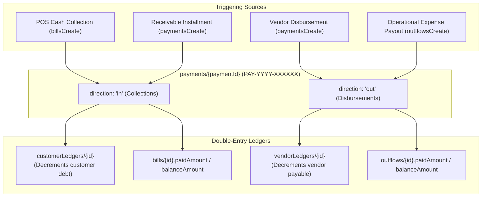
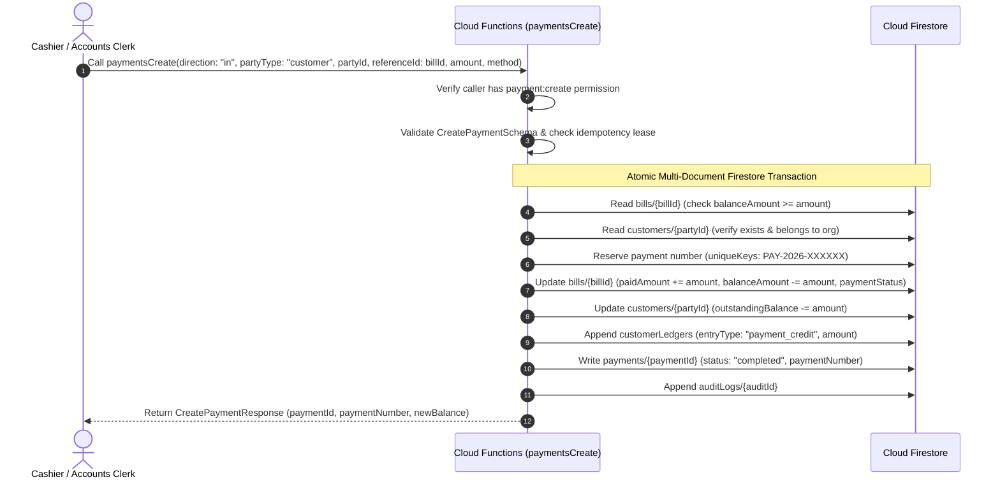
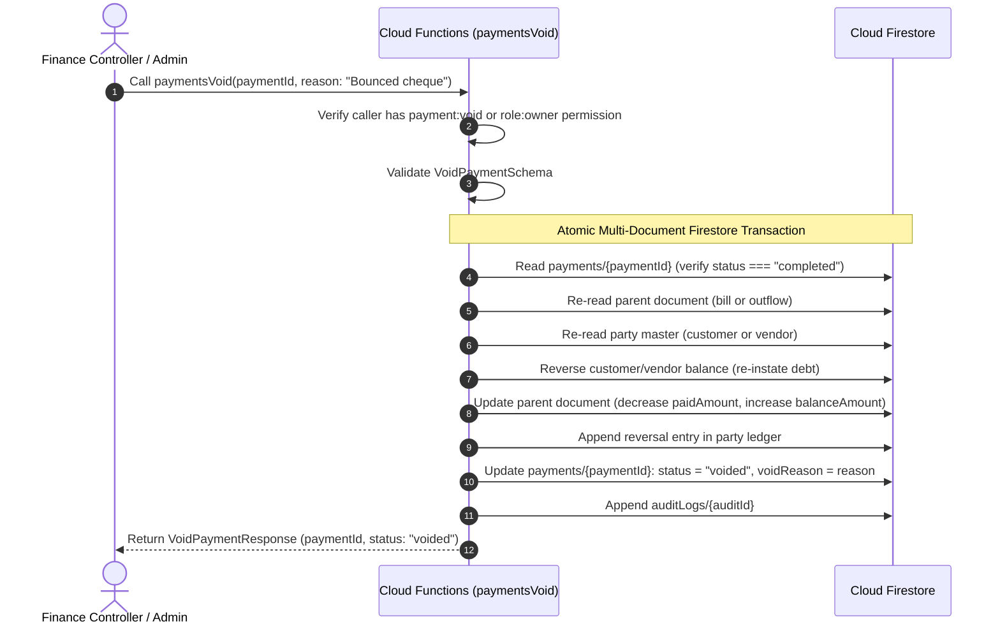

# Feature Guide: Payments & Party Ledgers

---

## 1. Module Overview & Financial Ledger Architecture

The Payments & Party Ledgers module manages financial settlements, partial debt payments, payment voiding, and double-entry reconciliation for Trado:
- **Standalone Payments Ledger (`payments/{paymentId}`)**: A dedicated, immutable log of all incoming and outgoing monetary flows. Every transaction issues an atomic sequential number (`PAY-YYYY-XXXXXX`).
- **Directional Categorization**:
  - `direction: "in"`: Incoming cash, card, UPI, or wire collections from customers.
  - `direction: "out"`: Outgoing supplier disbursements, operational expense payouts, or employee reimbursements.
- **Counterparty & Document References**: Payments link directly to parent documents (`referenceId`: `billId` or `outflowId`) and counterparty masters (`partyType`: `customer`, `vendor`, `employee`, or `other`).
- **Double-Entry Ledgers**:
  - `customerLedgers/{ledgerId}`: Debits from invoices, credits from payments and sales returns.
  - `vendorLedgers/{ledgerId}`: Credits from purchases, debits from disbursements and purchase returns.
- **Payment Voiding & Reversal (`paymentsVoid`)**: Securely cancels erroneous payments, rolling back customer/vendor debt balances and marking the payment voided.



---

## 2. End-to-End Sequence Diagrams

### 2.1 Follow-Up Customer Payment (`paymentsCreate`)



### 2.2 Payment Voiding & Reversal Flow (`paymentsVoid`)



---

## 3. Supported Payment Methods & Gateways

| Payment Method | Direction | Semantics | Gateway Reference Field |
| :--- | :--- | :--- | :--- |
| **`cash`** | In / Out | Physical currency drawer collection or payout | N/A |
| **`upi`** | In | Instant QR / VPA collection (India) | `gateway.externalReference` (UPI RRN) |
| **`card`** | In | POS debit/credit card swipe | `gateway.cardBrand`, `gateway.cardLast4` |
| **`bank_transfer`**| In / Out | NEFT / RTGS / IMPS / Wire transfer | Bank UTR / Transaction reference number |
| **`cheque`** | In / Out | Bank clearance instrument | Cheque number |
| **`credit_note`** | In | Settled against approved sales return | `referenceId` links to return voucher |

> [!IMPORTANT]
> **PCI-DSS Compliance**: Sensitive payment credentials (raw card numbers, CVVs, expiry dates, or UPI PINs) are **never** accepted, transmitted, or logged. The gateway DTO stores only the last 4 digits (`cardLast4`) and provider authorization codes.

---

## 4. API Reference & Parameter Specifications

### 4.1 `paymentsCreate`
Records an incoming receipt or outgoing disbursement against an invoice, purchase, or as a standalone balance settlement.

#### Request Parameters
```typescript
interface CreatePaymentRequest {
  idempotencyKey?: string;           // 8-128 char unique lease key
  organizationId?: string;           // Optional (derived from token context)
  branchId?: string;                 // Optional (derived from token context)
  direction: "in" | "out";           // "in" (customer receipt) | "out" (vendor disbursement)
  partyType: "customer" | "vendor" | "employee" | "other";
  partyId?: string | null;           // Target party master ID
  partyName?: string;                // Free-text name for one-off / unregistered parties
  amount: number;                    // Positive transaction amount
  method: PaymentMethod;             // "cash" | "upi" | "card" | "bank_transfer" | "cheque" | "credit_note"
  referenceId?: string | null;       // Associated billId or outflowId
  referenceModel?: "bill" | "outflow" | null;
  notes?: string;                    // Max 500 characters
  gateway?: {
    externalReference?: string;      // UPI RRN, card auth code, wire UTR
    gatewayProvider?: string;        // "razorpay" | "stripe" | "pos_terminal"
    gatewayStatus?: "initiated" | "authorized" | "captured" | "failed" | "refunded";
    cardBrand?: string;              // "visa" | "mastercard" | "rupay"
    cardLast4?: string;              // Exact 4 digits regex
  };
}
```

#### Success Response (200 OK)
```json
{
  "paymentId": "pay_5a6b7c8d9e",
  "organizationId": "org_apex_sample",
  "paymentNumber": "PAY-2026-000085",
  "direction": "in",
  "amount": 3000.00,
  "method": "upi",
  "status": "completed",
  "message": "Payment recorded successfully."
}
```

#### Common Error Codes
- `invalid-argument`: Payment amount exceeds parent invoice's remaining balance.
- `not-found`: Parent bill, outflow, customer, or vendor does not exist in caller's organization.

---

### 4.2 `paymentsVoid`
Safely voids a previously completed payment and rolls back all ledgers.

#### Request Parameters
```typescript
interface VoidPaymentRequest {
  paymentId: string;                 // Target payment ID to void
  reason: string;                    // 3-500 characters, mandatory reason
  idempotencyKey?: string;           // Optional lease key
}
```

#### Success Response (200 OK)
```json
{
  "paymentId": "pay_5a6b7c8d9e",
  "status": "voided",
  "voidReason": "Customer cheque bounced due to signature mismatch",
  "message": "Payment voided and party debt balance restored successfully."
}
```

---

## 5. Manual Emulator Testing Commands

```powershell
# 1. Run Retail POS Checkout & Payment Ledgers Test
node functions/scripts/test-e2e-retail-lifecycle.cjs

# 2. Reconcile Customer and Vendor Ledgers against Master Balances
node functions/scripts/test-e2e-business-flow.cjs
```
