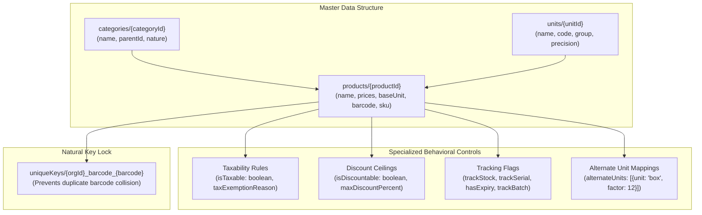
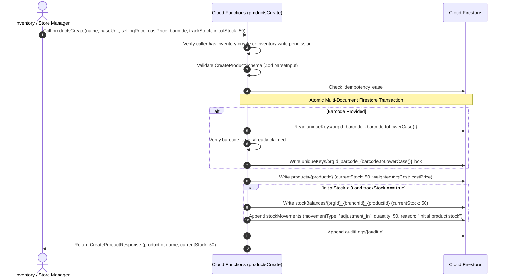

# Feature Guide: Products, Categories, Units & Barcodes

---

## 1. Module Overview & Catalog Architecture

The Product Catalog Engine manages master items, categorization hierarchies, multi-unit conversions, barcode concurrency locks, taxability rules, and discount ceilings for Trado:
- **Product Master (`products/{productId}`)**: Master catalog item containing retail/wholesale pricing, cost price, base counting unit, tax rates, tax exemption flags, discount caps, physical dimensions, and stock control flags.
- **Category Hierarchy (`categories/{categoryId}`)**: Multi-level organizational hierarchy with optional parent linkage (`parentId`) and nature tags.
- **Units & Measurement Conversions (`units/{unitId}`)**: Units of measure (e.g. `piece`, `kg`, `box`, `pack`, `meter`) and conversion factor mappings.
- **Alternate Units (`alternateUnits`)**: Defines box-to-piece or sack-to-kg conversion factors (e.g. 1 box = 12 pieces) with dedicated unit selling prices and purchase/sale unit toggles.
- **Barcode Concurrency Locks (`uniqueKeys/{lockId}`)**: Tenant-scoped natural key locks preventing duplicate barcode or SKU registration under concurrent API calls.



---

## 2. Product-Level Taxability & Discount Rules

### 2.1 Taxability & Exemption Controls
- **`isTaxable: boolean`**: Defaults to `true`. When set to `false`, the product is legally tax-exempt (e.g. fresh unprocessed agricultural grains, unbranded milk, bread). The billing and tax engines force **0% tax** regardless of the organization's tax regime or item tax code.
- **`taxExemptionReason: string`**: Required or snapshotted whenever a tax-exempt product is billed (e.g. "Notification 2/2017 Central Tax - Fresh Agricultural Produce").

### 2.2 Discountability & Ceiling Controls
- **`isDiscountable: boolean`**: Defaults to `true`. When set to `false`, the product is strictly price-controlled (e.g. government-subsidized fertilizer, regulated medicine, fixed-margin electronics). The billing engine will throw an `invalid-argument` error if any line or header discount is allocated to this item.
- **`maxDiscountPercent: number`**: Configurable maximum discount cap (0% to 100%). If a cashier or sales executive attempts a discount higher than this threshold, the billing engine rejects the request.

---

## 3. End-to-End Sequence Diagrams

### 3.1 Creating a Product with Initial Stock (`productsCreate`)



---

## 4. API Reference & Parameter Specifications

### 4.1 `productsCreate`
Creates a master product, sets up natural key barcode locks, and optionally seeds opening shelf stock.

#### Request Parameters
```typescript
interface CreateProductRequest {
  idempotencyKey?: string;           // 8-128 char unique lease key
  organizationId?: string;           // Optional (derived from token context)
  branchId?: string;                 // Optional (derived from token context)
  name: string;                      // 1-150 characters, product name
  description?: string;              // Max 1000 characters
  categoryId?: string | null;        // Category reference ID
  baseUnit: string;                  // Default: "piece" (must match code in units)
  sellingPrice: number;              // Standard retail selling price
  costPrice: number;                 // Base procurement cost price
  mrp?: number | null;               // Maximum Retail Price
  wholesalePrice?: number | null;    // Wholesale tier pricing
  taxInclusive?: boolean;            // Default: false
  taxRatePercent?: number;           // Standard tax rate percentage (e.g. 5, 12, 18)
  taxCode?: string;                  // HSN / SAC code
  barcode?: string | null;           // Scannable barcode (UPC / EAN / custom)
  sku?: string | null;               // Stock Keeping Unit
  hasExpiry?: boolean;               // Perishable item flag (default: false)
  trackStock?: boolean;              // Default: true (set false for services/freight)
  initialStock?: number;             // Opening stock quantity (default: 0)
  lowStockThreshold?: number;        // Reorder alert threshold (default: 5)
  trackBatch?: boolean;              // Enable batch/lot tracking
  trackSerial?: boolean;             // Enable individual serial/IMEI tracking
  isTaxable?: boolean;               // Default: true (false = 0% tax enforced)
  taxExemptionReason?: string;       // Reason for 0% tax exemption
  isDiscountable?: boolean;          // Default: true (false = discounts forbidden)
  maxDiscountPercent?: number;       // Discount ceiling (0 to 100)
  isReturnable?: boolean;            // Can customer return this item?
  returnWindowDays?: number;         // Allowed return window in days
  alternateUnits?: Array<{           // Alternate unit conversions (e.g. box of 12)
    unit: string;                    // Alternate unit name (e.g. "box")
    factor: number;                  // Multiplier (e.g. 12 base units per box)
    sellingPrice?: number;           // Unit price when sold as alternate unit
    wholesalePrice?: number;
    barcode?: string;
    isPurchaseUnit?: boolean;
    isSaleUnit?: boolean;
  }>;
  brand?: string;
  weight?: { value: number; unit: string };
  dimensions?: { length?: number; width?: number; height?: number; unit: string };
  imagePaths?: string[];             // Cloud Storage object paths
}
```

#### Success Response (200 OK)
```json
{
  "productId": "prod_1a2b3c4d5e",
  "organizationId": "org_apex_sample",
  "name": "Whole Wheat Bread 400g",
  "baseUnit": "pack",
  "sellingPrice": 45.00,
  "costPrice": 32.00,
  "currentStock": 50,
  "status": "active",
  "message": "Product created successfully."
}
```

---

### 4.2 `productsUpdate`
Updates catalog attributes, pricing, or taxability.

#### Request Parameters
```typescript
interface UpdateProductRequest {
  productId: string;                 // Target product ID
  name?: string;
  description?: string;
  categoryId?: string | null;
  sellingPrice?: number;
  costPrice?: number;
  wholesalePrice?: number | null;
  taxRatePercent?: number;
  isTaxable?: boolean;
  taxExemptionReason?: string;
  isDiscountable?: boolean;
  maxDiscountPercent?: number;
  barcode?: string | null;           // Reclaims uniqueKeys lock if modified
  isActive?: boolean;
}
```

---

## 5. Manual Emulator Testing Commands

```powershell
# 1. Run Schema and Validation tests for Products, Units and Categories
node functions/scripts/test-callable-schemas.cjs

# 2. Run Two-Business Simulation (Bicycle variants and Kitchenware multi-unit box conversions)
node functions/scripts/test-two-business-simulation.cjs

# 3. Check seeded products and category reference data
node functions/lib/scripts/seed-emulator.js --check
```
