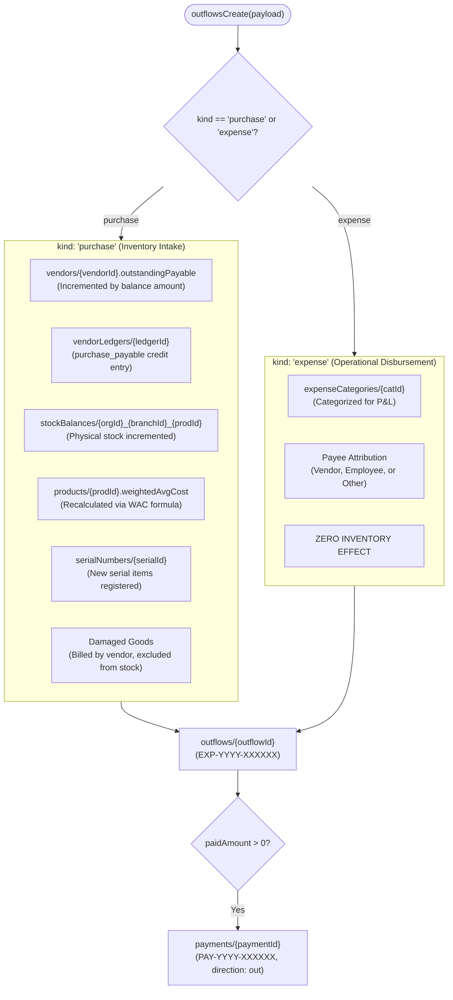
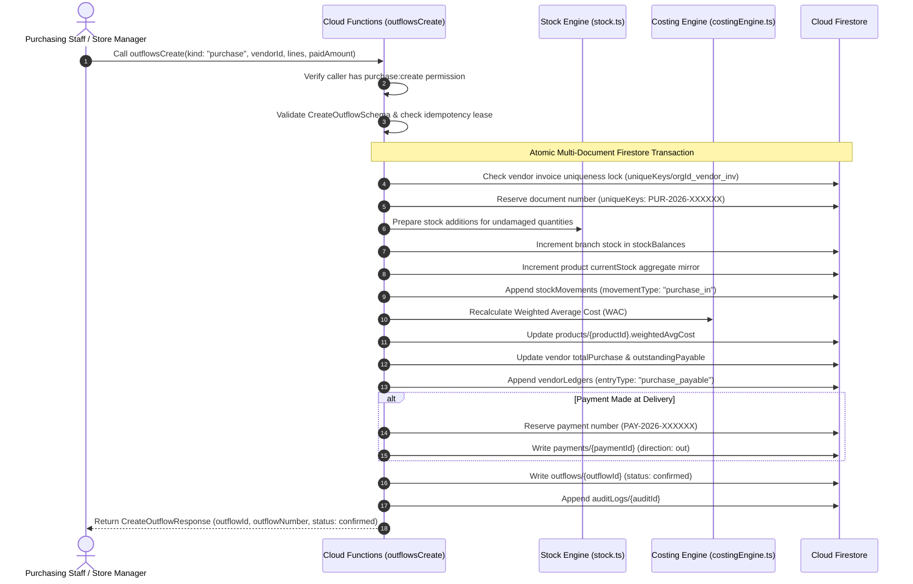

# Feature Guide: Purchases & Expenses (Unified Outflows Engine)

---

## 1. Module Overview & Unified Outflow Architecture

Trado unifies all outward financial disbursements and inventory procurement under the **Outflows Engine**:
- **Unified Master Collection (`outflows/{outflowId}`)**: Consolidates inventory purchases and non-inventory business expenses into a single polymorphic schema differentiated by the `kind` field.
- **Purchase Outflows (`kind: "purchase"`)**: Handles vendor procurement, physical goods receipt at the operating branch, damaged-on-receipt accounting, serial number registration, Weighted Average Cost (WAC) recalculation, and vendor payables tracking.
- **Expense Outflows (`kind: "expense"`)**: Handles operational overhead (rent, electricity, delivery logistics, petty cash, tea/snacks) with **zero physical inventory effect** and multi-category categorization.
- **Recurring Expense Automation (`recurringExpenses/{templateId}`)**: Cron-triggered generation of periodic recurring expenses (rent, internet, SaaS subscriptions).



---

## 2. Inward Purchase vs Operational Expense Matrix

| Architectural Dimension | Purchase Outflows (`kind: "purchase"`) | Expense Outflows (`kind: "expense"`) |
| :--- | :--- | :--- |
| **Document Number Prefix** | `PUR-YYYY-XXXXXX` (e.g. `PUR-2026-000012`) | `EXP-YYYY-XXXXXX` (e.g. `EXP-2026-000008`) |
| **Primary Counterparty** | Requires registered `vendorId` | `vendorId` optional; supports `payeeMembershipId` or free-text `payee` |
| **Physical Stock Balance** | **Incremented atomically** at operating branch | **Strictly untouched** (0 inventory movement) |
| **Costing & Valuation** | Updates product `weightedAvgCost` (WAC) | Capitalized directly into P&L operational expense |
| **Vendor Payables** | Increments `vendor.outstandingPayable` | No vendor ledger debit unless linked to vendor |
| **Damaged Goods Handling** | Supported via `damagedQuantity` & `damageReason` | Not applicable |
| **Serial Numbers** | Registers inbound IMEI / Frame numbers | Not applicable |
| **Duplicate Invoice Lock** | Enforced via `uniqueKeys/orgId_vendor_invoice_{no}` | No invoice lock |

---

## 3. End-to-End Sequence Diagrams

### 3.1 Inward Vendor Purchase Workflow (`outflowsCreate`)



---

## 4. Costing Engine & Damaged Goods Accounting

### 4.1 Weighted Average Cost (WAC) Formula
When receiving a purchase shipment with undamaged quantity $Q_{\text{in}}$ at unit price $P_{\text{in}}$:

$$\text{WAC}_{\text{new}} = \frac{(Q_{\text{current}} \times \text{WAC}_{\text{current}}) + (Q_{\text{in}} \times P_{\text{in}})}{Q_{\text{current}} + Q_{\text{in}}}$$

- **Decimal Precision**: WAC is computed and persisted with **4 decimal places** (e.g. ₹142.8571) to ensure zero rounding drift across bulk sales and fractional measurements.
- **Initial Inventory**: When $Q_{\text{current}} == 0$, $\text{WAC}_{\text{new}} = P_{\text{in}}$.

### 4.2 Damaged Goods on Receipt
If 20 units are shipped but 2 are damaged in transit:
- Billed Quantity = 20 (payable to vendor is $20 \times P$).
- `damagedQuantity` = 2, with `damageReason` (e.g. "punctured in transit").
- Inward Stock Added = 18 units into `stockBalances`.
- The damaged units are permanently recorded on the outflow line for credit note claim without inflating physical shelf stock.

---

## 5. API Reference & Parameter Specifications

### 5.1 `outflowsCreate`
Creates an inward purchase or records an operational expense.

#### Who Can Call
- **Purchases**: Users with `purchase:create` (e.g. `role_purchase_staff`, `role_store_manager`, `role_admin`, `role_org_owner`).
- **Expenses**: Users with `expense:create` (e.g. `role_admin`, `role_org_owner`, `role_store_manager`).

#### Request Parameters
```typescript
interface CreateOutflowRequest {
  idempotencyKey?: string;           // 8-128 char unique lease key
  organizationId?: string;           // Optional (derived from token context)
  branchId?: string;                 // Optional (derived from token context)
  kind: "purchase" | "expense";      // Discriminator: purchase vs expense
  docDate?: string;                  // ISO date (defaults to current timestamp)
  vendorId?: string | null;          // Registered vendor ID (required for purchases)
  payee?: string;                    // Free-text payee for unlisted vendors / one-off expenses
  payeeType?: "vendor" | "employee" | "other";
  payeeMembershipId?: string;        // Employee membership ID (for expense reimbursements)
  expenseCategoryId?: string;        // Target operational expense category
  invoiceNumber?: string;            // Vendor's legal invoice / bill reference number
  dueDate?: string;                  // Credit payment due date (YYYY-MM-DD)
  lines: Array<{
    productId?: string | null;       // Product ID (catalog lines)
    itemName?: string;               // Name for non-catalog expense lines
    categoryId?: string | null;      // Category for non-catalog lines
    quantity: number;                // Positive quantity
    unit: string;                    // Base or alternate unit (e.g. "piece", "box")
    unitPrice: number;               // Purchase cost per unit
    discountAmount?: number;         // Line-level trade discount
    taxPercent?: number;             // Tax percentage (0-100)
    addToStock?: boolean;            // Defaults to true (set false for expense materials)
    batch?: string;                  // Inward batch number
    expiryDate?: string;             // Expiry date for perishable goods
    damagedQuantity?: number;        // Units received damaged (never enters stock)
    damageReason?: string;           // Explanation of damage
    serialNumbers?: string[];        // Array of serial numbers (for serial-tracked items)
  }>;
  billDiscountAmount?: number;       // Bill-level cash discount
  billDiscountPercent?: number;      // Bill-level percentage discount
  paidAmount?: number;               // Cash/bank disbursement made at receipt
  paymentMethod?: PaymentMethod;     // "cash" | "upi" | "card" | "bank_transfer"
  notes?: string;                    // Max 1000 characters
  attachmentPaths?: string[];        // Cloud Storage object paths for invoice/receipt scans
}
```

#### Success Response (`CreateOutflowResponse`)
```json
{
  "outflowId": "outflow_98a7b6c5d4",
  "organizationId": "org_apex_sample",
  "outflowNumber": "PUR-2026-000018",
  "kind": "purchase",
  "totalAmount": 18500.00,
  "paidAmount": 5000.00,
  "balanceAmount": 13500.00,
  "paymentStatus": "partial",
  "paymentId": "pay_33b2c1d0",
  "status": "confirmed",
  "message": "Purchase recorded successfully."
}
```

#### Common Error Codes
- `already-exists`: Vendor invoice number already recorded under this vendor (`uniqueKeys/orgId_vendor_invoice_{no}`).
- `permission-denied`: Caller lacks `purchase:create` or `expense:create`, or cross-tenant vendor reference.
- `invalid-argument`: Product is serial-tracked but serial count does not match undamaged quantity.

---

### 5.2 `recurringExpensesRunPending`
Scheduled or manual execution of recurring expense templates.

#### Who Can Call
- **Platform Super Admin** or **Tenant Admin / Owner** with `expense:create`.

#### Execution Logic
- Queries `recurringExpenses` where `status === "active"` and `nextRunDate <= today`.
- Generates corresponding `outflows/{outflowId}` with `kind: "expense"`.
- Advances `nextRunDate` based on recurrence frequency (`monthly`, `quarterly`, `annually`).

---

## 6. Manual Emulator Testing Commands

```powershell
# 1. Run Inward Purchase, Serial Tracking & Transit Damage Simulation
node functions/scripts/test-two-business-simulation.cjs

# 2. Run Live Outflow Event Trigger & WAC Calculation verification
node functions/scripts/test-event-triggers.cjs

# 3. Verify Recurring Expense and Governance sweeps
node functions/scripts/test-governance-flagship.cjs
```
