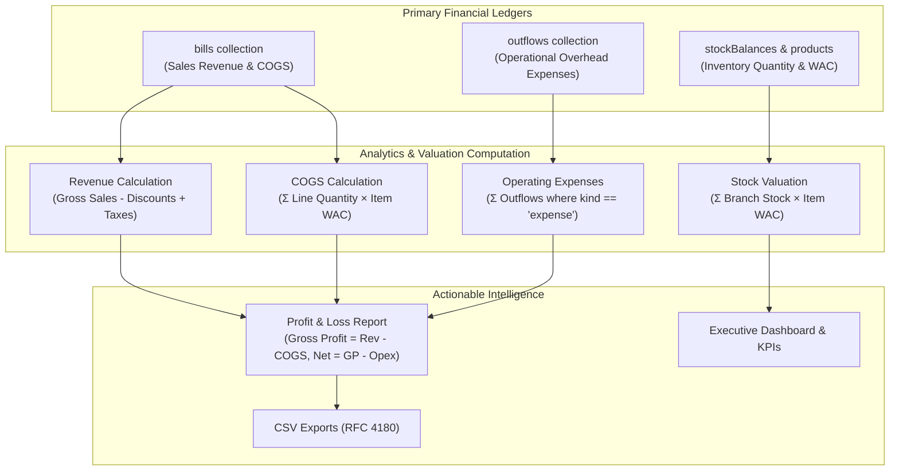

# Feature Guide: Reports & Analytics Engine

---

## 1. Module Overview & Analytics Architecture

The Reports & Analytics Engine provides operational intelligence, real-time Firestore aggregations, financial P&L reporting, inventory valuation, and multi-format CSV exports for Trado:
- **Revenue Analytics (`reportsGetRevenue`)**: Aggregates sales volume, ticket size, and revenue across time intervals (`day`, `month`, `year`).
- **Profit & Loss (`reportsGetProfitLoss`)**: Computes Net Profit by subtracting Weighted Average Cost (WAC) COGS and operational expenses from revenue.
- **Stock Valuation (`reportsGetStockValuation`)**: Values current physical inventory using 4-decimal WAC rates, scoped by branch or across the entire organization.
- **Top Entities (`reportsGetTopEntities`)**: Identifies highest-velocity products, top-revenue customers, or major suppliers.
- **Staff Performance (`reportsGetStaffActivity`)**: Analyzes revenue generated and ticket count by salesperson.
- **CSV Data Export (`reportsExportCsv`)**: Exports raw aggregated reports into RFC 4180-compliant CSV format with branch scoping.



---

## 2. Mathematical Formulas & Accounting Invariants

### 2.1 Profit & Loss Mechanics
$$\text{Gross Revenue} = \sum_{\text{finalized bills}} \text{bill.subTotal} - \text{bill.discountTotal}$$

$$\text{COGS (Cost of Goods Sold)} = \sum_{\text{finalized bill items}} (\text{item.quantity} \times \text{product.weightedAvgCost})$$

$$\text{Gross Profit} = \text{Gross Revenue} - \text{COGS}$$

$$\text{Operating Expenses} = \sum_{\text{outflows (kind == 'expense')}} \text{outflow.totalAmount}$$

$$\text{Net Profit} = \text{Gross Profit} - \text{Operating Expenses}$$

### 2.2 Inventory Stock Valuation
$$\text{Branch Inventory Valuation} = \sum_{p \in \text{products}} (\text{stockBalances}[p].\text{currentStock} \times \text{WAC}_p)$$

---

## 3. API Reference & Parameter Specifications

### 3.1 `reportsGetRevenue`
Aggregates sales revenue and ticket count over a date range.

#### Request Parameters
```typescript
interface GetRevenueReportRequest {
  organizationId?: string;           // Optional (derived from token context)
  branchId?: string;                 // Optional (scope to specific branch)
  from?: string;                     // YYYY-MM-DD start date
  to?: string;                       // YYYY-MM-DD end date
  groupBy?: "day" | "month" | "year";// Default: "day"
}
```

#### Success Response (200 OK)
```json
{
  "totalRevenue": 245000.00,
  "billCount": 182,
  "averageBillValue": 1346.15,
  "breakdown": [
    { "period": "2026-11-01", "revenue": 14200.00, "count": 12 },
    { "period": "2026-11-02", "revenue": 18500.00, "count": 15 }
  ]
}
```

---

### 3.2 `reportsGetProfitLoss`
Computes financial profit and loss statement.

#### Request Parameters
```typescript
interface GetProfitLossReportRequest {
  organizationId?: string;
  branchId?: string;
  from?: string;                     // YYYY-MM-DD
  to?: string;                       // YYYY-MM-DD
}
```

#### Success Response (200 OK)
```json
{
  "revenue": 245000.00,
  "cogs": 172000.00,
  "grossProfit": 73000.00,
  "operatingExpenses": 21500.00,
  "netProfit": 51500.00,
  "grossMarginPercent": 29.80,
  "netMarginPercent": 21.02
}
```

---

### 3.3 `reportsGetStockValuation`
Computes total inventory asset valuation using WAC.

#### Request Parameters
```typescript
interface GetStockValuationReportRequest {
  organizationId?: string;
  branchId?: string;                 // Optional: values specific branch; omitted: values whole org
  categoryId?: string;               // Optional category filter
}
```

#### Success Response (200 OK)
```json
{
  "totalValuation": 485200.00,
  "totalItemCount": 1240,
  "distinctProductCount": 48
}
```

---

## 4. Manual Emulator Testing Commands

```powershell
# 1. Run Platform Analytics and Reporting Test Suite
node functions/scripts/test-analytics-platform.cjs

# 2. Run Retail POS Lifecycle and Financial Report Verification
node functions/scripts/test-e2e-retail-lifecycle.cjs
```
