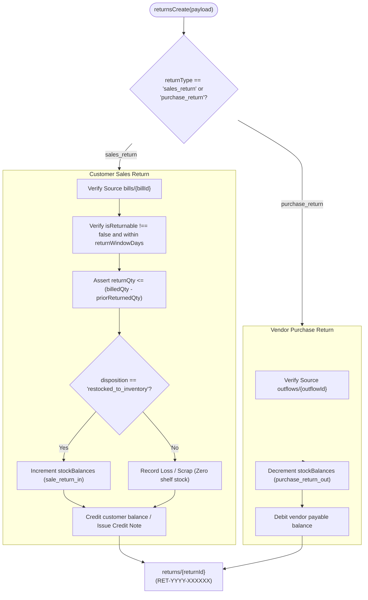
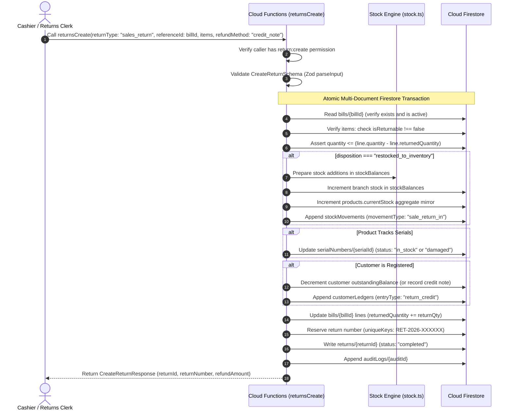

# Feature Guide: Returns, Waste & Stock Adjustments

---

## 1. Module Overview & Return Lifecycles

This module manages goods returns, customer refunds, credit notes, non-returnable product enforcement, and inventory write-offs for Trado:
- **Unified Returns Master (`returns/{returnId}`)**: Records customer returns (`returnType: "sales_return"`) and vendor returns (`returnType: "purchase_return"`).
- **Disposition Engine**: Controls physical item disposition:
  - `restocked_to_inventory`: Item is undamaged and restocked into active shelf stock in `stockBalances`.
  - `damaged_write_off`: Item is broken or unusable; not returned to active shelf stock.
- **Refund & Settlement Modes**: Cash refund, original payment method reversal, or credit note issuance.
- **Over-Return Guard**: Strict validation preventing returns exceeding the remaining returnable quantity on the source document:
  $$\text{Returnable Qty} = \text{Billed Qty} - \sum \text{Prior Returns}$$
- **Non-Returnable Product Protection**: Products flagged with `isReturnable: false` (e.g. personal hygiene items, custom-cut cables, food items) are automatically rejected by `returnsCreate`.
- **Return Window Enforcement**: Verifies return occurs within `product.returnWindowDays`.



---

## 2. End-to-End Sequence Diagrams

### 2.1 Customer Sales Return & Credit Note Workflow (`returnsCreate`)



---

## 3. API Reference & Parameter Specifications

### 3.1 `returnsCreate`
Processes a customer sales return or vendor purchase return.

#### Request Parameters
```typescript
interface CreateReturnRequest {
  idempotencyKey?: string;           // 8-128 char unique lease key
  organizationId?: string;           // Optional (derived from token context)
  branchId?: string;                 // Optional (derived from token context)
  returnType: "sales_return" | "purchase_return";
  referenceId: string;               // billId (for sales) or outflowId (for purchases)
  refundMethod?: "cash" | "credit_note" | "original_payment";
  notes?: string;                    // Max 500 characters
  items: Array<{
    productId: string;               // Returned product ID
    sourceLineId?: string;           // Required if item appears on multiple document lines
    quantity: number;                // Positive return quantity
    refundAmount: number;            // Total monetary refund for this line
    reason: string;                  // Mandatory reason (e.g. "Customer ordered wrong size")
    disposition: "restocked_to_inventory" | "damaged_write_off";
    serialNumbers?: string[];        // Required if product has trackSerial: true
  }>;
}
```

#### Success Response (200 OK)
```json
{
  "returnId": "ret_3c4d5e6f7a",
  "organizationId": "org_apex_sample",
  "returnNumber": "RET-2026-000014",
  "returnType": "sales_return",
  "refundAmount": 150.00,
  "refundMethod": "credit_note",
  "status": "completed",
  "message": "Return processed and stock restocked successfully."
}
```

#### Common Error Codes
- `invalid-argument`: Product is non-returnable (`isReturnable === false`), return quantity exceeds remaining returnable quantity, or return window has expired.
- `not-found`: Source bill or outflow document does not exist in caller's organization.

---

## 4. Manual Emulator Testing Commands

```powershell
# 1. Run Two-Business Simulation (Tests non-returnable toilet brush rejection)
node functions/scripts/test-two-business-simulation.cjs

# 2. Run Retail POS Lifecycle and Return verification
node functions/scripts/test-e2e-retail-lifecycle.cjs
```
