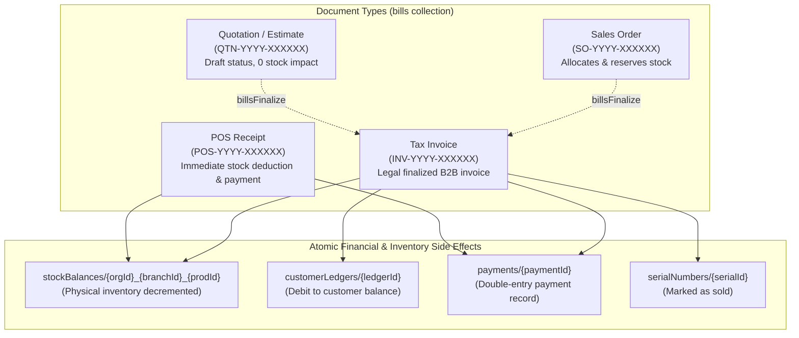
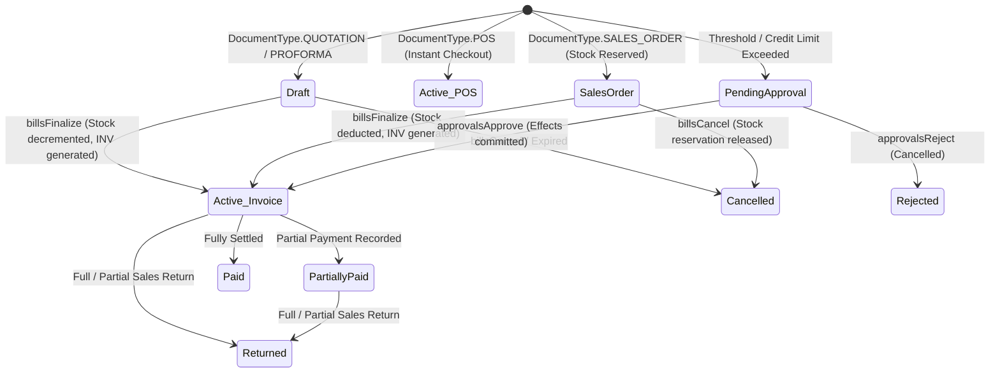
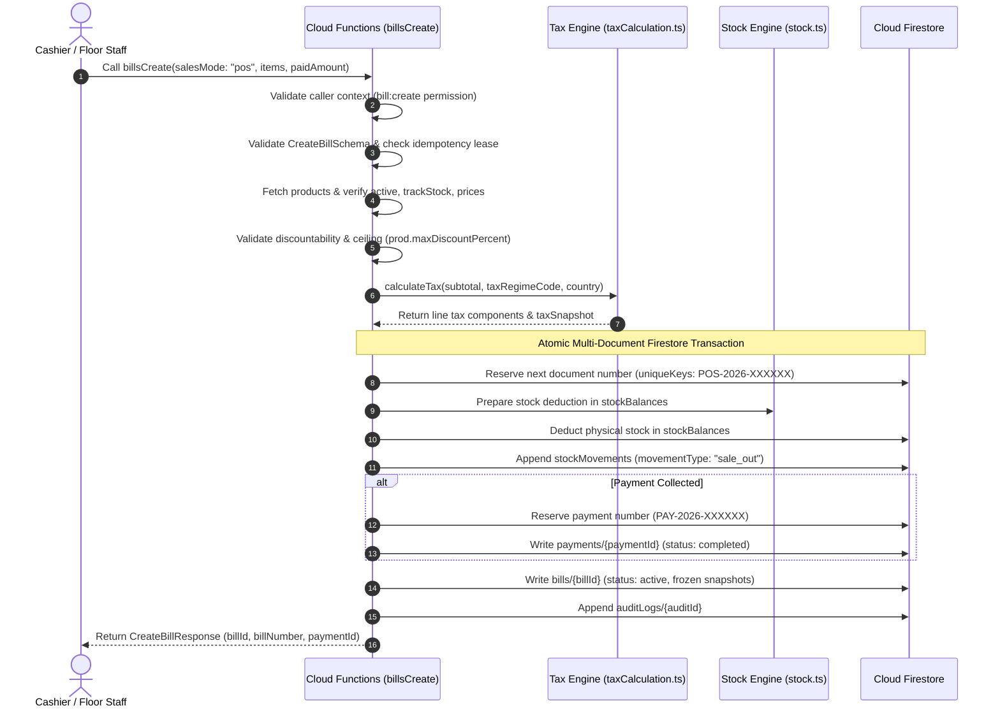
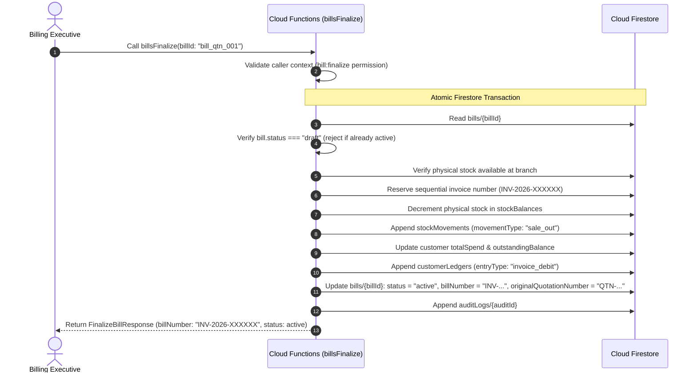

# Feature Guide: Sales, Billing & Quotations Engine

---

## 1. Module Overview & Billing Topologies

The Sales & Billing module provides unified Point-of-Sale (POS) and B2B wholesale invoicing for Trado:
- **Unified Document Master (`bills/{billId}`)**: A single polymorphic collection storing retail cash tickets, quotations, sales orders, pro-forma invoices, and finalized legal Tax Invoices.
- **Draft & Quotation Preservation**: Quotations (`QTN`) and draft documents reserve zero physical stock and generate zero customer ledger debt.
- **Atomic Stock Deduction**: Finalized invoices decrement branch physical inventory (`stockBalances`), record audit movements (`stockMovements`), update customer balances, and create payment receipts in a single atomic Firestore transaction.
- **Global Tax & Exemption Engine**: Supports 7 international tax regimes (`IN_GST`, `AE_VAT`, `OM_VAT`, `BH_VAT`, `SG_GST`, `US_SALES_TAX`, `NONE`) with product-level taxability (`isTaxable`) and exemption snapshotting.
- **Discount Safeguards**: Enforces non-discountable product protection (`isDiscountable: false`) and maximum line discount ceilings (`maxDiscountPercent`).



---

## 2. Document Lifecycles & State Transitions



---

## 3. End-to-End Sequence Diagrams

### 3.1 Point-of-Sale (POS) Checkout Flow (`billsCreate`)



### 3.2 B2B Quotation to Finalized Tax Invoice (`billsFinalize`)



---

## 4. Global Tax Engine & Discount Rules

### 4.1 Supported International Tax Regimes

| Tax Regime Code | Country | Jurisdiction | Tax Rate Mechanics | Calculation Formula |
| :--- | :--- | :--- | :--- | :--- |
| **`IN_GST`** | India (`IN`) | Intra-State ($POS_{state} == Org_{state}$) | Split 50/50 into CGST + SGST | $CGST = \text{round}(Tax/2), \; SGST = Tax - CGST$ |
| **`IN_GST`** | India (`IN`) | Inter-State ($POS_{state} \neq Org_{state}$) | 100% allocated to IGST | $IGST = Tax, \; CGST = 0, \; SGST = 0$ |
| **`AE_VAT`** | UAE (`AE`) | National Standard Rate | 5% destination VAT | $VAT = \text{round}(Subtotal \times 0.05)$ |
| **`OM_VAT`** | Oman (`OM`) | National Standard Rate | 5% destination VAT | $VAT = \text{round}(Subtotal \times 0.05)$ |
| **`BH_VAT`** | Bahrain (`BH`)| National Standard Rate | 10% destination VAT | $VAT = \text{round}(Subtotal \times 0.10)$ |
| **`SG_GST`** | Singapore (`SG`)| Standard Rated GST | 9% standard GST | $GST = \text{round}(Subtotal \times 0.09)$ |
| **`US_SALES_TAX`**| US (`US`) | State / County Destination | Dynamic destination rate | $Tax = \text{round}(Subtotal \times Rate)$ |
| **`NONE`** | Global | Tax Exempt / Zero Rated | 0% tax | $Tax = 0$ |

### 4.2 Product-Level Taxability & Exemption Overrides
- **`isTaxable: false`**: If a product has `isTaxable === false`, the billing engine automatically overrides its tax calculation to **0%**, regardless of the organization's tax regime or item tax code.
- **`taxExemptionReason`**: Required or snapshotted whenever a tax-exempt product is billed, preserving legal compliance for government audits.

### 4.3 Discount Precedence & Ceiling Protection
```
Line Item Base Amount = Quantity × Unit Price Override
  ├── Check isDiscountable !== false (rejection if false)
  ├── Validate Line Discount <= maxDiscountPercent (rejection if exceeded)
  ├── Net Line Taxable = Base Amount - Line Discount
  ├── Prorate Bill-Level Discount (only across discountable items)
  └── Final Taxable Base ──> Calculate Tax Engine ──> Final Line Total
```

---

## 5. API Reference & Parameter Specifications

### 5.1 `billsCreate`
Generates a POS bill, quotation, sales order, or B2B invoice.

#### Who Can Call
- Users with `bill:create` (e.g. `role_cashier`, `role_store_manager`, `role_admin`, `role_org_owner`).

#### Request Parameters
```typescript
interface CreateBillRequest {
  idempotencyKey?: string;           // 8-128 char unique lease key
  organizationId?: string;           // Optional (derived from token context)
  branchId?: string;                 // Optional (derived from token context)
  salesMode?: SalesMode;             // "pos" | "b2b" (default: "pos")
  documentType?: DocumentType;       // "invoice" | "quotation" | "sales_order" | "proforma" (default: "invoice")
  status?: "draft" | "active";       // Default: "active" (forced to "draft" for quotation)
  customerId?: string | null;        // Registered customer ID
  walkInCustomer?: {                 // Walk-in counterparty details (only without customerId)
    name: string;
    mobile?: string;
    taxNumber?: string;
    billingAddress?: string;
  };
  items: Array<{
    productId: string;               // Target product ID
    quantity: number;                // Positive quantity
    unitPriceOverride?: number;      // Optional authorized price override
    discountValue?: number;          // Flat line discount amount
    unit?: string;                   // Optional alternate unit (e.g. "box")
    serialNumbers?: string[];        // Array of serial numbers (for serial-tracked items)
  }>;
  discountTotal?: number;            // Bill-level header discount
  paidAmount?: number;               // Amount collected immediately at billing
  paymentMethod?: PaymentMethod;     // "cash" | "upi" | "card" | "bank_transfer"
  notes?: string;                    // Max 1000 characters
}
```

#### Success Response (`CreateBillResponse`)
```json
{
  "billId": "bill_6a7b8c9d0e",
  "organizationId": "org_apex_sample",
  "billNumber": "POS-2026-000042",
  "salesMode": "pos",
  "documentType": "invoice",
  "totalAmount": 1450.00,
  "paidAmount": 1450.00,
  "balanceAmount": 0.00,
  "paymentStatus": "paid",
  "paymentId": "pay_99a8b7c6",
  "status": "active",
  "message": "Bill generated successfully."
}
```

#### Common Error Codes
- `invalid-argument`: Negative quantity, invalid serial count, discount exceeding `maxDiscountPercent`, or line on non-discountable item.
- `failed-precondition`: Insufficient physical stock at branch (when `allowNegativeStock === false`).
- `not-found`: Product or customer not found in caller's organization.

---

### 5.2 `billsFinalize`
Transitions a quotation or draft sales order into an active, legal Tax Invoice.

#### Request Parameters
```typescript
interface FinalizeBillRequest {
  billId: string;                    // Target bill ID
  idempotencyKey?: string;           // Optional lease key
}
```

#### Success Response (200 OK)
```json
{
  "billId": "bill_6a7b8c9d0e",
  "billNumber": "INV-2026-000105",
  "status": "active",
  "totalAmount": 4200.00,
  "balanceAmount": 4200.00,
  "message": "Quotation finalized into Tax Invoice successfully."
}
```

---

## 6. Manual Emulator Testing Commands

```powershell
# 1. Run Retail POS Lifecycle End-to-End Suite
node functions/scripts/test-e2e-retail-lifecycle.cjs

# 2. Run Two-Business Simulation (Bicycle serial tracking & Kitchenware unit conversion)
node functions/scripts/test-two-business-simulation.cjs

# 3. Run Live Bill Event Trigger tests
node functions/scripts/test-event-triggers.cjs
```
