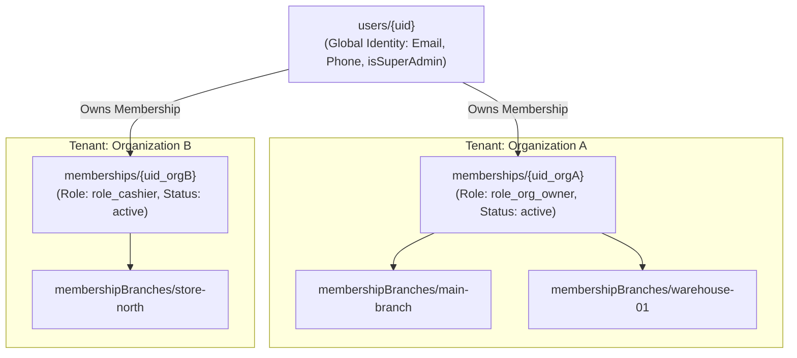
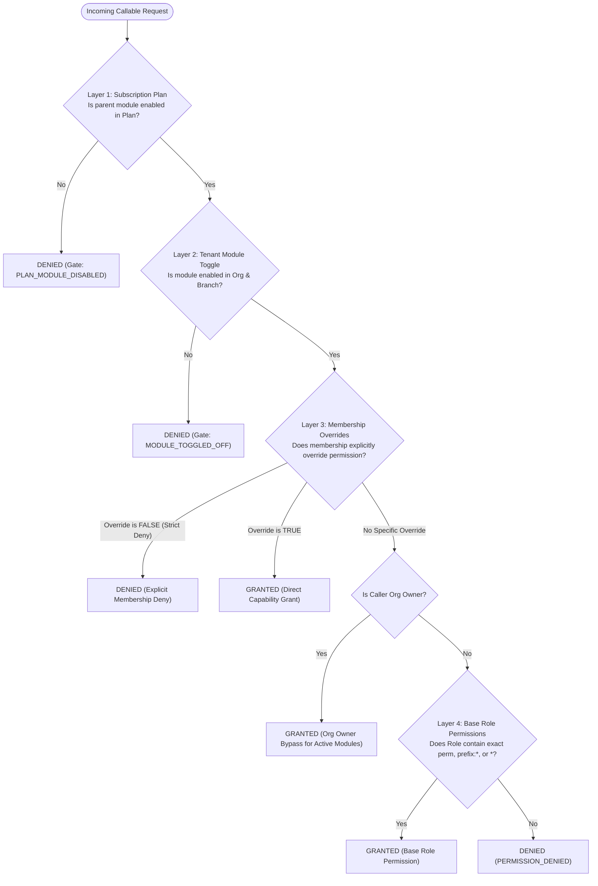
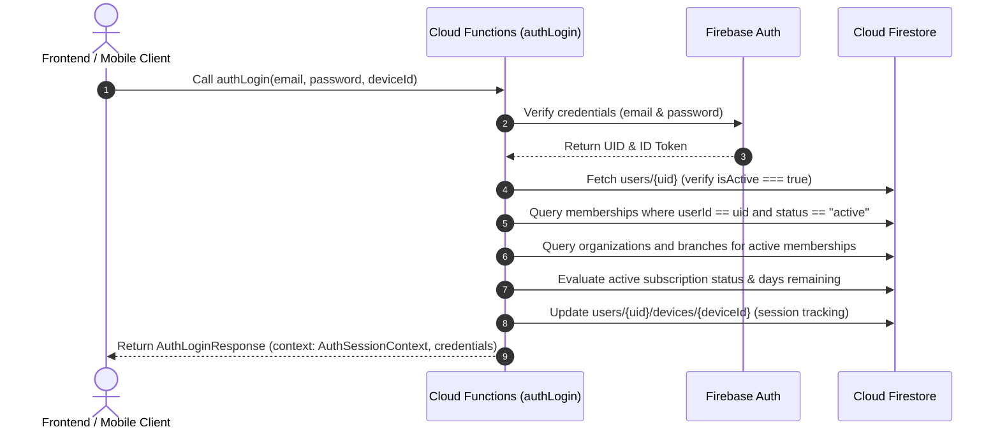
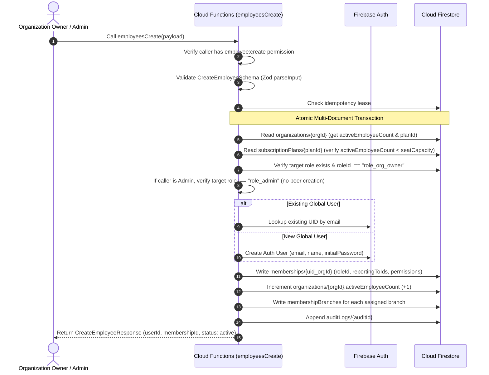

# Feature Guide: Users, Memberships & RBAC Permissions

---

## 1. Module Overview & Multi-Tenant Identity Architecture

Trado decouples global user identity from tenant-scoped operational access:
- **Global User Identity (`users/{userId}`)**: A single record per human identity containing authenticated email, phone, system flags (`isSuperAdmin`), and active default preferences. A single user can belong to multiple independent tenant organizations.
- **Tenant Membership (`memberships/{userId}_{orgId}`)**: The bridge binding a global user to a specific organization. Defines their base role (`roleId`), reporting hierarchy (`reportingToIds`), job roles (`jobRoleIds`), team (`teamId`), and fine-grained capability overrides (`permissions`).
- **Branch Operating Assignment (`membershipBranches/{membershipId}_{branchId}`)**: Dictates which physical branches within the organization the employee is authorized to operate in, and flags their default branch (`isDefaultForMembership`).
- **Four-Layer RBAC Engine**: Evaluates every callable invocation through four successive evaluation gates with strict deny precedence.



---

## 2. The Four-Layer RBAC Evaluation Engine

When an authenticated user invokes any protected HTTPS callable, `resolveRequestContext` executes four deterministic evaluation checks:



### Precedence Rules
1. **Platform Super Admin Boundary**: Super Admins have `isSuperAdmin: true` for platform operations, but are strictly forbidden from mutating tenant operational records (`SUPER_ADMIN_TENANT_FORBIDDEN`).
2. **Module Gating Overrides Everything**: If a module (e.g. `billing`, `inventory`, `deliveries`) is turned off in the organization or subscription plan, no role or individual permission override can enable access.
3. **Strict Deny First**: If an individual membership override sets `"bill:discount": false`, the cashier is denied discount privileges even if their base role grants `"bill:*"` or `"*"`.
4. **Live In-Flight Revocation**: Context resolution performs a live document fetch of the caller's user and membership records. If an employee is deactivated, their active JWT is rejected on their immediate next request without waiting for token expiry.

---

## 3. End-to-End Sequence Diagrams

### 3.1 Unified Authentication Login (`authLogin`)



### 3.2 Provisioning Staff Member (`employeesCreate`)



---

## 4. API Reference & Parameter Specifications

### 4.1 `authLogin`
Unified authentication callable serving all user types (Platform Admins, Org Owners, Managers, Cashiers, and Delivery Riders).

#### Request Parameters
```typescript
interface AuthLoginRequest {
  email: string;                     // Valid email address (case-insensitive)
  password: string;                  // Plain-text password (min 1, max 512 chars)
  deviceId?: string;                 // Optional client hardware/installation ID (4-128 chars)
}
```

#### Success Response (`AuthLoginResponse`)
```json
{
  "context": {
    "user": {
      "uid": "usr_abc123",
      "email": "owner@apexwholesale.local",
      "name": "Apex Owner",
      "accountType": "admin",
      "isActive": true,
      "isSuperAdmin": false
    },
    "role": {
      "scope": "organization",
      "roleId": "role_org_owner",
      "roleName": "Organization Owner",
      "roleCode": "org_owner"
    },
    "jobRoles": [],
    "permissions": ["*"],
    "primaryOrganization": {
      "organizationId": "org_apex_sample",
      "name": "Apex Wholesale Supplies"
    },
    "primaryBranch": {
      "branchId": "main-branch",
      "name": "Main Branch",
      "code": "MAIN"
    },
    "subscription": {
      "state": "active",
      "planId": "plan_growth",
      "expiresAt": "2027-11-08T00:00:00.000Z",
      "daysRemaining": 365
    },
    "contextStatus": "ready"
  },
  "credentials": {
    "idToken": "eyJhbGciOiJSUzI1NiIs...",
    "expiresInSeconds": 3600
  }
}
```

---

### 4.2 `employeesCreate`
Provisions an employee, assigns roles and branch access, and commits seat counters inside an atomic transaction.

#### Who Can Call
- **Organization Owner (`role_org_owner`)** or **Tenant Administrator (`role_admin`)** with `employee:create`.
- **Anti-Escalation Constraints**:
  - An Admin cannot assign `role_org_owner`.
  - An Admin cannot assign `role_admin` (cannot create peer Administrators).
  - An Admin cannot assign custom permissions they do not possess.

#### Request Parameters
```typescript
interface CreateEmployeeRequest {
  idempotencyKey?: string;           // Optional 8-128 char unique lease key
  organizationId: string;            // Target organization ID
  email: string;                     // Employee email address
  name: string;                      // 2-100 characters, full name
  phone?: string;                    // Optional mobile number
  initialPassword?: string;          // Optional password; generated if omitted
  roleId?: string;                   // Default: "role_employee"
  departmentId?: string;             // Optional department ID
  jobRoleIds?: string[];             // Optional array of job role IDs (max 20)
  teamId?: string;                   // Optional operational team ID
  reportingToIds?: string[];         // Array of manager membership IDs (max 10)
  permissionOverrides?: Record<string, boolean>; // e.g. { "bill:discount": false }
  branchIds?: string[];              // Authorized operating branches (defaults to main-branch)
  defaultBranchId?: string;          // Primary branch for employee
}
```

#### Success Response (200 OK)
```json
{
  "userId": "usr_staff_4455",
  "membershipId": "usr_staff_4455_org_apex_sample",
  "organizationId": "org_apex_sample",
  "status": "active",
  "message": "Employee provisioned successfully."
}
```

#### Error Handling & Invariant Enforcement
- `resource-exhausted`: Thrown if `activeEmployeeCount >= plan.seatLimits.total`.
- `invalid-argument`: Thrown if reporting hierarchy forms a circular dependency ($A \to B \to A$) or reporting manager belongs to another tenant.
- `already-exists`: User is already an active member of this organization.

---

### 4.3 `employeesUpdate`
Updates employee profile, role assignments, reporting lines, or permission overrides.

#### Who Can Call
- **Organization Owner** or **Admin** with `employee:update`.
- Cannot update their own role (anti-self-escalation).

#### Request Parameters
```typescript
interface UpdateEmployeeRequest {
  organizationId: string;
  membershipId: string;              // Target membership ID to update
  name?: string;
  phone?: string;
  roleId?: string;                   // Subject to tier validation
  departmentId?: string | null;
  jobRoleIds?: string[];
  teamId?: string | null;
  reportingToIds?: string[];         // Cycle check enforced
  permissionOverrides?: Record<string, boolean>;
  status?: EntityStatus;             // "active" | "inactive" | "suspended"
  dataScopes?: Record<
    "sales" | "purchases" | "expenses" | "deliveries" | "returns" | "payments" | "stock" | "tasks",
    "self" | "team" | "branch" | "organization"
  >;
}
```

#### Success Response (200 OK)
```json
{
  "membershipId": "usr_staff_4455_org_apex_sample",
  "updatedAt": "2026-11-08T18:05:00.000Z",
  "message": "Employee record updated successfully."
}
```

---

### 4.4 `employeesDeactivate`
Soft-deactivates an employee's membership in the calling organization.

#### Who Can Call
- **Organization Owner** or **Admin** with `employee:delete`.

#### Request Parameters
```typescript
interface DeactivateEmployeeRequest {
  organizationId: string;
  membershipId: string;
  reason?: string;                   // Optional explanation for deactivation
}
```

#### Invariants & Multi-Tenant Behavior
- Sets `memberships/{membershipId}.status = "inactive"`.
- Decrements `organizations/{orgId}.activeEmployeeCount` (-1).
- Does **not** delete the global `users/{uid}` profile if the user holds active memberships in other organizations.

---

## 5. System Roles & Permission Catalog

### 5.1 Default System Roles

| Role Code | Role ID | Target Persona | Base Capabilities |
| :--- | :--- | :--- | :--- |
| `org_owner` | `role_org_owner` | Organization Owner | Full unrestricted bypass on all active tenant modules (`*`) |
| `admin` | `role_admin` | Operations Administrator | Daily management of catalog, staff, orders, and branch operations |
| `store_manager` | `role_store_manager` | Warehouse / Store Manager | Inventory stock adjustments, inward purchases, approvals |
| `cashier` | `role_cashier` | POS / Floor Cashier | Billing POS sales, receiving customer payments, viewing catalog |
| `purchase_staff` | `role_purchase_staff` | Procurement Clerk | Recording inward purchases, goods receipt, vendor creation |
| `rider` | `role_rider` | Delivery Dispatcher | Managing assigned deliveries, door cash collection, live status |
| `employee` | `role_employee` | General Staff Member | Basic catalog lookup, self tasks, and location pinging |

---

## 6. Manual Emulator Testing Commands

```powershell
# 1. Run Flagship Governance and Privilege Denial Test Suite (487 denial assertions)
node functions/scripts/test-governance-flagship.cjs

# 2. Run Callable Schema boundary and validation tests
node functions/scripts/test-callable-schemas.cjs

# 3. Verify in-flight revocation and negative persona rejections
node functions/lib/scripts/seed-emulator.js --check
```
