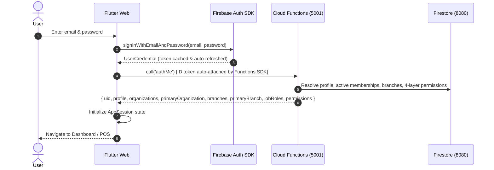

# Trado Firebase Backend — Flutter Web Client Integration Guide

This guide is the canonical backend integration reference for Flutter Web developers building the Trado frontend. It covers architecture, local emulator connection, authentication bootstrap, typed callable invocation patterns, code generation from OpenAPI, key business workflows, and backend invariants.

---

## 1. Architecture Overview

Trado's backend is implemented as 2nd Generation Firebase Cloud Functions running on Node.js 22 in the **`asia-south1`** (Mumbai) region.

```
┌────────────────────────────────────────────────────────┐
│                   Flutter Web Client                   │
│   (firebase_auth, cloud_functions, firebase_core)      │
└──────────────┬─────────────────────────┬───────────────┘
               │ HTTPS (Callable)        │ ID Token
               ▼                         ▼
┌──────────────────────────┐    ┌────────────────────────┐
│ Cloud Functions (2nd Gen)│    │ Firebase Auth          │
│ Region: asia-south1      │    │ (Tenant & Super Admin) │
│ 101 HTTPS Callables      │    └────────────────────────┘
└──────────────┬───────────┘
               │ Admin SDK
               ▼
┌──────────────────────────┐
│ Cloud Firestore          │
│ 44 Collections           │
│ Multi-Tenant Isolation   │
└──────────────────────────┘
```

### Key Technical Parameters
| Parameter | Value | Details |
|---|---|---|
| **Firebase Project ID** | `trado-x` | Required for all Firebase SDK initializations. |
| **Functions Region** | `asia-south1` | Must specify `region: 'asia-south1'` in `FirebaseFunctions.instanceFor()`. |
| **Transport** | HTTPS Callables (`onCall`) | Automatic Auth token attachment, JSON payload wrapping `{ data: ... }`. |
| **Multi-Tenancy Model** | Shared database with document-level `organizationId` | Every business entity is scoped by `organizationId`. |
| **Branch Scoping** | Subcollection `organizations/{orgId}/branches` | Single-branch users locked to their branch; multi-branch users can select. |

---

## 2. Local Development & Emulator Configuration

When running locally, Flutter Web connects to the Firebase Emulator Suite running on `127.0.0.1`.

### 2.1 Dependencies in `pubspec.yaml`
```yaml
dependencies:
  flutter:
    sdk: flutter
  firebase_core: ^3.6.0
  firebase_auth: ^5.3.1
  cloud_functions: ^5.1.3
  uuid: ^4.5.1
```

### 2.2 Emulator Bootstrap in `lib/main.dart`
```dart
import 'package:flutter/foundation.dart';
import 'package:flutter/material.dart';
import 'package:firebase_core/firebase_core.dart';
import 'package:firebase_auth/firebase_auth.dart';
import 'package:cloud_functions/cloud_functions.dart';

const bool kUseFirebaseEmulator = bool.fromEnvironment('USE_EMULATOR', defaultValue: true);
const String kFunctionsRegion = 'asia-south1';

Future<void> main() async {
  WidgetsFlutterBinding.ensureInitialized();

  await Firebase.initializeApp(
    options: const FirebaseOptions(
      apiKey: 'fake-api-key-for-emulator',
      appId: '1:1234567890:web:abcdef123456',
      messagingSenderId: '1234567890',
      projectId: 'trado-x',
      authDomain: 'trado-x.firebaseapp.com',
      storageBucket: 'trado-x.appspot.com',
    ),
  );

  if (kUseFirebaseEmulator) {
    configureEmulators();
  }

  runApp(const TradoApp());
}

void configureEmulators() {
  const localhost = '127.0.0.1';

  // 1. Auth Emulator (Port 9099)
  FirebaseAuth.instance.useAuthEmulator(localhost, 9099);

  // 2. Cloud Functions Emulator (Port 5001, Region asia-south1)
  FirebaseFunctions.instanceFor(region: kFunctionsRegion).useFunctionsEmulator(localhost, 5001);

  debugPrint('Connected to Firebase Emulators on loopback (127.0.0.1).');
}
```

> [!NOTE]
> On Flutter Web, `127.0.0.1` refers to your local machine browser environment. Start the local backend and seed personas via:
> ```powershell
> # 1. Compile backend functions
> npm --prefix functions run build
> 
> # 2. Start Firebase Emulators (Terminal 1)
> $env:FUNCTIONS_DISCOVERY_TIMEOUT = "60"
> firebase emulators:start --project trado-x
> 
> # 3. Seed demo organizations & personas (Terminal 2)
> node functions/lib/scripts/seed-emulator.js --profile api-explorer-demo
> 
> # 4. Generate OpenAPI specification (Terminal 2)
> node scripts/generate-openapi.js
> 
> # 5. Launch Local API Explorer (Terminal 2)
> node tools/api-explorer/server.js
> # → Open browser to http://127.0.0.1:3939
> ```

---

## 3. Authentication & Session Bootstrap Lifecycle

Trado supports two authentication flows, designed for different client environments:
1. **Canonical Production Flow (Flutter Web & Mobile)**: Uses the native Firebase Authentication SDK (`signInWithEmailAndPassword`) followed by `authMe` to fetch the bootstrap context. This flow leverages the official SDK's automatic token persistence, cryptographic validation, and background token refresh.
2. **Testing & Tooling Adapter Flow (`authLogin` Callable)**: A unified HTTPS callable designed for non-SDK developer environments (local API Explorer, Swagger UI, curl, Postman, `.http` workbenches) that cannot run the Firebase Auth client SDK.

### 3.1 Canonical Production Flow (Flutter SDK + `authMe`)

In production Flutter applications, the client signs in through `FirebaseAuth`:
1. Call `await FirebaseAuth.instance.signInWithEmailAndPassword(email: email, password: password);`.
2. The Firebase Auth SDK mints the ID token, manages token refreshing, and automatically attaches the token to all subsequent Cloud Functions callable invocations via `Authorization: Bearer <idToken>`. **The Flutter client never needs to manually inject tokens into JSON request bodies.**
3. Immediately after login, invoke the `authMe` callable to retrieve the authoritative user profile, tenant organization, assigned branches, job roles, and resolved 4-layer permissions.



```dart
/// Canonical Flutter Web Authentication Service
class AuthService {
  final FirebaseAuth _auth = FirebaseAuth.instance;
  final CallableClient _functions = CallableClient();

  Future<AuthSessionContext> signInWithEmailPassword({
    required String email,
    required String password,
    String? deviceId,
  }) async {
    // 1. Authenticate with native Firebase Auth SDK (handles tokens & auto-refresh)
    await _auth.signInWithEmailAndPassword(email: email, password: password);

    // 2. Fetch authoritative user context, organizations, branches, and permissions
    final data = await _functions.call<Map<String, dynamic>>('authMe', {
      if (deviceId != null) 'deviceId': deviceId,
    });
    final response = AuthMeResponse.fromJson(data);
    return response.context;
  }

  Future<void> signOut() async {
    await _auth.signOut();
  }
}
```

### 3.2 Testing Adapter Flow (`authLogin` Callable)

For Swagger UI, curl, and automated test runners that cannot run the Firebase Auth SDK, `authLogin` accepts `{ email, password, deviceId? }` and returns complete tokens and context in a single call.

```dart
Future<AuthLoginResponse> loginViaAdapter({
  required CallableClient client,
  required String email,
  required String password,
  String? deviceId,
}) async {
  final payload = <String, dynamic>{
    'email': email,
    'password': password,
    if (deviceId != null) 'deviceId': deviceId,
  };

  final data = await client.call<Map<String, dynamic>>('authLogin', payload);
  return AuthLoginResponse.fromJson(data);
}
```

### 3.3 Server-Derived Tenant Context (No Client `organizationId` Required)

For all business operations (`billsCreate`, `productsCreate`, `customersCreate`, `vendorsCreate`, `outflowsCreate`, `stockAdjust`, `deliveriesCreate`, `returnsCreate`, `paymentsCreate`), the backend server-side derives `organizationId` and `branchId` from the verified caller's Firebase Auth token (`primaryOrganizationId`, `primaryBranchId`) or active Firestore memberships:
- **Do NOT send `organizationId` in request bodies**: The backend automatically resolves the caller's active tenant organization.
- **Forgery Prevention**: If a client attempts to pass an explicit `organizationId` that does not match their verified membership, the backend immediately rejects the call with `permission-denied` (`"Cross-tenant access rejected."`).
- **Branch Context**: By default, operations resolve to the caller's primary branch (or org default). Multi-branch users who switch branches can supply `branchId` to explicitly target one of their assigned branches.

### 3.4 Super Admin Platform Isolation Invariant

The Platform Super Admin operates above all tenant organizations and branches:
- `user.isSuperAdmin`: `true`
- `organizations`: `[]` (strictly empty list)
- `primaryOrganization`: `null`
- `branches`: `[]` (strictly empty list)
- `primaryBranch`: `null`
- `role`: `{ scope: "platform", roleId: null, roleName: "Platform Super Admin", roleCode: "super_admin" }`
- `jobRoles`: `[]`
- `permissions`: `[]` (STRICT: zero tenant permissions! Super Admin never bypasses tenant boundaries)
- `platformPermissions`: `["platform:*"]` (unrestricted platform capability)
- `contextStatus`: `"platform"`

Super Admin possesses no tenant organization memberships. When invoking explicit platform administrative functions (such as `organizationsDeactivate` or `branchesDeactivate`), Super Admin supplies the target `organizationId` explicitly.

### 3.5 Dart Session Models (`AuthLoginResponse` and `AuthMeResponse`)

```dart
class AuthSessionContext {
  final AuthUserContext user;
  final AuthRoleContext? role;
  final List<AuthJobRoleContext> jobRoles;
  final List<String> permissions;
  final List<String> platformPermissions;
  final List<AuthOrganizationContext> organizations;
  final AuthPrimaryOrganizationContext? primaryOrganization;
  final List<AuthBranchContext> branches;
  final AuthPrimaryBranchContext? primaryBranch;
  final AuthDeviceContext? device;
  final String contextStatus;

  AuthSessionContext({
    required this.user,
    this.role,
    this.jobRoles = const [],
    this.permissions = const [],
    this.platformPermissions = const [],
    this.organizations = const [],
    this.primaryOrganization,
    this.branches = const [],
    this.primaryBranch,
    this.device,
    required this.contextStatus,
  });

  bool get isSuperAdmin => user.isSuperAdmin;

  bool hasPermission(String permission) {
    if (isSuperAdmin && permission.startsWith('platform:')) return true;
    return permissions.contains(permission);
  }

  factory AuthSessionContext.fromJson(Map<String, dynamic> json) {
    return AuthSessionContext(
      user: AuthUserContext.fromJson(json['user'] as Map<String, dynamic>? ?? {}),
      role: json['role'] != null ? AuthRoleContext.fromJson(json['role'] as Map<String, dynamic>) : null,
      jobRoles: (json['jobRoles'] as List<dynamic>?)
              ?.map((j) => AuthJobRoleContext.fromJson(j as Map<String, dynamic>))
              .toList() ??
          [],
      permissions: (json['permissions'] as List<dynamic>?)?.cast<String>() ?? [],
      platformPermissions: (json['platformPermissions'] as List<dynamic>?)?.cast<String>() ?? [],
      organizations: (json['organizations'] as List<dynamic>?)
              ?.map((o) => AuthOrganizationContext.fromJson(o as Map<String, dynamic>))
              .toList() ??
          [],
      primaryOrganization: json['primaryOrganization'] != null
          ? AuthPrimaryOrganizationContext.fromJson(json['primaryOrganization'] as Map<String, dynamic>)
          : null,
      branches: (json['branches'] as List<dynamic>?)
              ?.map((b) => AuthBranchContext.fromJson(b as Map<String, dynamic>))
              .toList() ??
          [],
      primaryBranch: json['primaryBranch'] != null
          ? AuthPrimaryBranchContext.fromJson(json['primaryBranch'] as Map<String, dynamic>)
          : null,
      device: json['device'] != null ? AuthDeviceContext.fromJson(json['device'] as Map<String, dynamic>) : null,
      contextStatus: json['contextStatus'] as String? ?? 'ready',
    );
  }
}

class AuthCredentials {
  final String idToken;
  final int expiresInSeconds;

  AuthCredentials({required this.idToken, required this.expiresInSeconds});

  factory AuthCredentials.fromJson(Map<String, dynamic> json) {
    return AuthCredentials(
      idToken: json['idToken'] as String? ?? '',
      expiresInSeconds: json['expiresInSeconds'] as int? ?? 3600,
    );
  }
}

class AuthLoginResponse {
  final AuthSessionContext context;
  final AuthCredentials credentials;

  AuthLoginResponse({required this.context, required this.credentials});

  factory AuthLoginResponse.fromJson(Map<String, dynamic> json) {
    final res = json['result'] as Map<String, dynamic>? ?? json;
    return AuthLoginResponse(
      context: AuthSessionContext.fromJson(res['context'] as Map<String, dynamic>? ?? {}),
      credentials: AuthCredentials.fromJson(res['credentials'] as Map<String, dynamic>? ?? {}),
    );
  }
}

class AuthMeResponse {
  final AuthSessionContext context;
  final dynamic credentials;

  AuthMeResponse({required this.context, this.credentials});

  factory AuthMeResponse.fromJson(Map<String, dynamic> json) {
    final res = json['result'] as Map<String, dynamic>? ?? json;
    return AuthMeResponse(
      context: AuthSessionContext.fromJson(res['context'] as Map<String, dynamic>? ?? {}),
      credentials: res['credentials'],
    );
  }
}

class AuthUserContext {
  final String uid;
  final String email;
  final String name;
  final String? phone;
  final String? avatarUrl;
  final String accountType;
  final bool isActive;
  final bool isSuperAdmin;

  AuthUserContext({
    required this.uid,
    required this.email,
    required this.name,
    this.phone,
    this.avatarUrl,
    required this.accountType,
    required this.isActive,
    required this.isSuperAdmin,
  });

  factory AuthUserContext.fromJson(Map<String, dynamic> json) {
    return AuthUserContext(
      uid: json['uid'] as String? ?? '',
      email: json['email'] as String? ?? '',
      name: json['name'] as String? ?? '',
      phone: json['phone'] as String?,
      avatarUrl: json['avatarUrl'] as String?,
      accountType: json['accountType'] as String? ?? 'staff',
      isActive: json['isActive'] == true,
      isSuperAdmin: json['isSuperAdmin'] == true,
    );
  }
}

class AuthRoleContext {
  final String scope;
  final String? roleId;
  final String? roleName;
  final String? roleCode;

  AuthRoleContext({required this.scope, this.roleId, this.roleName, this.roleCode});

  factory AuthRoleContext.fromJson(Map<String, dynamic> json) {
    return AuthRoleContext(
      scope: json['scope'] as String? ?? 'organization',
      roleId: json['roleId'] as String?,
      roleName: json['roleName'] as String?,
      roleCode: json['roleCode'] as String?,
    );
  }
}

class AuthJobRoleContext {
  final String jobRoleId;
  final String name;
  final String code;

  AuthJobRoleContext({required this.jobRoleId, required this.name, required this.code});

  factory AuthJobRoleContext.fromJson(Map<String, dynamic> json) {
    return AuthJobRoleContext(
      jobRoleId: json['jobRoleId'] as String? ?? '',
      name: json['name'] as String? ?? '',
      code: json['code'] as String? ?? '',
    );
  }
}

class AuthOrganizationContext {
  final String organizationId;
  final String? name;
  final String? roleId;
  final String? roleName;
  final bool isPrimary;

  AuthOrganizationContext({
    required this.organizationId,
    this.name,
    this.roleId,
    this.roleName,
    this.isPrimary = false,
  });

  factory AuthOrganizationContext.fromJson(Map<String, dynamic> json) {
    return AuthOrganizationContext(
      organizationId: json['organizationId'] as String? ?? '',
      name: json['name'] as String?,
      roleId: json['roleId'] as String?,
      roleName: json['roleName'] as String?,
      isPrimary: json['isPrimary'] == true,
    );
  }
}

class AuthPrimaryOrganizationContext {
  final String organizationId;
  final String? name;

  AuthPrimaryOrganizationContext({required this.organizationId, this.name});

  factory AuthPrimaryOrganizationContext.fromJson(Map<String, dynamic> json) {
    return AuthPrimaryOrganizationContext(
      organizationId: json['organizationId'] as String? ?? '',
      name: json['name'] as String?,
    );
  }
}

class AuthBranchContext {
  final String branchId;
  final String name;
  final String code;
  final bool isDefault;

  AuthBranchContext({
    required this.branchId,
    required this.name,
    required this.code,
    this.isDefault = false,
  });

  factory AuthBranchContext.fromJson(Map<String, dynamic> json) {
    return AuthBranchContext(
      branchId: json['branchId'] as String? ?? '',
      name: json['name'] as String? ?? '',
      code: json['code'] as String? ?? '',
      isDefault: json['isDefault'] == true,
    );
  }
}

class AuthPrimaryBranchContext {
  final String branchId;
  final String name;
  final String code;

  AuthPrimaryBranchContext({required this.branchId, required this.name, required this.code});

  factory AuthPrimaryBranchContext.fromJson(Map<String, dynamic> json) {
    return AuthPrimaryBranchContext(
      branchId: json['branchId'] as String? ?? '',
      name: json['name'] as String? ?? '',
      code: json['code'] as String? ?? '',
    );
  }
}

class AuthDeviceContext {
  final String deviceId;
  final bool recognized;

  AuthDeviceContext({required this.deviceId, required this.recognized});

  factory AuthDeviceContext.fromJson(Map<String, dynamic> json) {
    return AuthDeviceContext(
      deviceId: json['deviceId'] as String? ?? '',
      recognized: json['recognized'] == true,
    );
  }
}
```

### 3.4 Invoking `authLogin` in Flutter

```dart
Future<AuthLoginResponse> login({
  required CallableClient client,
  required String email,
  required String password,
  String? deviceId,
}) async {
  final payload = <String, dynamic>{
    'email': email,
    'password': password,
    if (deviceId != null) 'deviceId': deviceId,
  };

  final data = await client.call<Map<String, dynamic>>('authLogin', payload);
  return AuthLoginResponse.fromJson(data);
}
```

### 3.2 Branch & Organization Switching
- **Branch-Locked Staff** (e.g., Cashier, Rider): Assigned to a single branch; `activeBranchId` is fixed by their employee record.
- **Multi-Branch Managers / Owners**: Have `*` or access to multiple branches. They can switch `activeBranchId` in the app's local state and supply `branchId` in write payloads.

---


### 3.6 `contextStatus` routing (subscription & organization state)

`authMe.context.contextStatus` is the router key. New locked states return **zero tenant permissions**, an empty branch list, and a `subscription` summary (`state`, `planId`, `expiresAt`, `graceEndsAt`, `daysRemaining`):

| `contextStatus` | Route |
|---|---|
| `ready` | Home (`primaryOrganization` + `primaryBranch` set) |
| `platform` | Super Admin console |
| `organization_selection_required` | Organization picker |
| `branch_selection_required` | Branch picker |
| `no_active_membership` | "No organization" screen |
| `organization_inactive` | Locked tenant screen (organization deactivated by the platform) |
| `subscription_expired` | Renewal screen (past expiry + grace) |
| `subscription_suspended` | Suspended / cancelled screen |
| `subscription_not_started` | "Subscription starts on …" screen |

When `subscription.state == "grace"`, show a renewal banner; operations still work. Status is evaluated live on every call, so a renewal by the platform takes effect without re-login.

### 3.7 Stable error reasons

Every gate failure sets `FirebaseFunctionsException.details['reason']` (and prefixes the message with `[REASON]`). Branch on the reason, not the message:

```dart
final reason = (e.details is Map) ? (e.details as Map)['reason'] as String? : null;
switch (reason) {
  case 'SUBSCRIPTION_EXPIRED':
  case 'SUBSCRIPTION_SUSPENDED':
    router.go('/subscription');
  case 'MODULE_NOT_IN_PLAN':
    showUpgradePrompt();
  case 'USAGE_LIMIT_EXCEEDED':
    showLimitBanner(e.details); // metric, period, usage, limit
  case 'PERMISSION_DENIED':
  case 'FIELD_NOT_EDITABLE':
    showAccessDenied();
  default:
    showError(e.message);
}
```

Full list: [API reference — Gate, Error Reasons & Lifecycle Callables](api-reference.md#gate-error-reasons--lifecycle-callables-2026-11-07).

### 3.8 Reads go through callables

Direct Firestore SDK reads of business collections (products, customers, vendors, bills, outflows, payments, returns, deliveries, stock movements, daily/monthly summaries) are **denied by security rules**: use the `*List` / `*Get` / report callables, which apply data scope and hide cost/balance fields the user may not see (fields are omitted, not zeroed). Direct reads remain allowed for the organization, branches, roles, catalogs, stock balances, and the caller's own notifications, tasks and location.

New callables relevant to the app: `billsApprove`, `billsVoid`, `outflowsApprove`, `outflowsVoid`, `teamsAssignMember`, `productsGetPriceHistory`, `auditGetEntityHistory`, `reportsGetPartyStatement`, `reportsGetOutflowSummary`. List responses of bills/outflows/payments/returns/deliveries include `scope` (`self` | `team` | `branch` | `organization`).

## 4. Calling Callables with `cloud_functions`

Firebase 2nd Gen Callables expect payload wrapped in `{ "data": payload }` and return `{ "result": data }`. The `cloud_functions` Flutter SDK automatically manages this wrapping and extracts the result.

### 4.1 Reusable `CallableClient` Pattern
```dart
import 'package:cloud_functions/cloud_functions.dart';

class CallableClient {
  final FirebaseFunctions _functions;

  CallableClient({String region = 'asia-south1'})
      : _functions = FirebaseFunctions.instanceFor(region: region);

  /// Invoke a Firebase Callable function safely with error mapping
  Future<T> call<T>(String functionName, Map<String, dynamic> payload) async {
    try {
      final callable = _functions.httpsCallable(
        functionName,
        options: HttpsCallableOptions(timeout: const Duration(seconds: 30)),
      );

      final result = await callable.call<dynamic>(payload);
      return result.data as T;
    } on FirebaseFunctionsException catch (e) {
      throw TradoApiException.fromFirebase(e);
    } catch (e) {
      throw TradoApiException(
        code: 'unknown',
        message: 'An unexpected client error occurred: $e',
      );
    }
  }
}

class TradoApiException implements Exception {
  final String code;
  final String message;
  final dynamic details;

  TradoApiException({required this.code, required this.message, this.details});

  factory TradoApiException.fromFirebase(FirebaseFunctionsException e) {
    return TradoApiException(
      code: e.code,
      message: e.message ?? 'Server returned an error',
      details: e.details,
    );
  }

  @override
  String toString() => 'TradoApiException [$code]: $message';
}
```

### 4.2 Standard Error Code Mapping
| Firebase Error Code | Meaning | Recommended UI Treatment |
|---|---|---|
| `unauthenticated` | User token missing or expired | Redirect to `/login`. |
| `permission-denied` | Missing role or permission code | Show "Access Denied" toast or dialog. |
| `invalid-argument` | Zod validation failed on backend | Highlight invalid form fields (inspect `details` for field errors). |
| `not-found` | Entity (bill, customer, product) not found | Show 404 message or refresh list. |
| `failed-precondition` | Business logic violated (e.g. insufficient stock) | Display user-friendly banner explaining why the operation was blocked. |
| `already-exists` | Idempotency or unique slug collision | Notify user that transaction was already completed. |

---

## 5. OpenAPI Contract & Code Generation

The backend OpenAPI 3.0.3 specification is generated automatically at:
- **`docs/openapi.json`**
- **`docs/openapi.yaml`**

### 5.1 Generating Dart DTOs with `openapi-generator-cli`
You can generate strongly-typed Dart data classes directly from `docs/openapi.json`:

```bash
# Using OpenAPI Generator
npx @openapitools/openapi-generator-cli generate \
  -i docs/openapi.json \
  -g dart \
  -o frontend/lib/api_generated
```

Alternatively, use `quicktype` for lightweight model classes:
```bash
npx quicktype -s schema docs/openapi.json -o frontend/lib/models/trado_models.dart --lang dart
```

---

## 6. Key Business Domain Workflows (with Dart Examples)

### 6.1 Catalog: Create Product with Multi-Branch Stock
```dart
import 'package:uuid/uuid.dart';

Future<Map<String, dynamic>> createProduct({
  required CallableClient client,
  required String organizationId,
  required String name,
  required String categoryId,
  required String primaryUnitId,
  required double sellingPrice,
  required double purchasePrice,
  required List<Map<String, dynamic>> branchInitialStock,
}) async {
  final payload = {
    'organizationId': organizationId,
    'name': name,
    'categoryId': categoryId,
    'primaryUnitId': primaryUnitId,
    'sellingPrice': sellingPrice,
    'purchasePrice': purchasePrice,
    'taxRate': 5.0,
    'trackInventory': true,
    'branchStock': branchInitialStock, // [{ branchId: 'main-branch', initialQuantity: 100 }]
    'idempotencyKey': const Uuid().v4(),
  };

  return await client.call<Map<String, dynamic>>('productsCreate', payload);
}
```

### 6.2 Billing & POS: Create and Finalize a Bill
```dart
Future<String> createAndFinalizeSale({
  required CallableClient client,
  required String organizationId,
  required String branchId,
  required String? customerId,
  required List<Map<String, dynamic>> items,
  required double totalAmount,
  required String paymentMethod,
}) async {
  // Step 1: Create Draft Bill
  final billRes = await client.call<Map<String, dynamic>>('billsCreate', {
    'organizationId': organizationId,
    'branchId': branchId,
    'partyId': customerId,
    'billType': 'tax_invoice',
    'items': items,
    'subtotal': totalAmount,
    'taxTotal': 0.0,
    'grandTotal': totalAmount,
    'idempotencyKey': const Uuid().v4(),
  });

  final billId = billRes['billId'] as String;

  // Step 2: Finalize Bill and Record Payment
  await client.call<Map<String, dynamic>>('billsFinalize', {
    'organizationId': organizationId,
    'billId': billId,
    'paymentDetails': {
      'method': paymentMethod, // 'cash', 'upi', 'card', 'bank_transfer', 'credit'
      'amount': totalAmount,
    },
    'idempotencyKey': const Uuid().v4(),
  });

  return billId;
}
```

### 6.3 Party Ledger: Record Customer Payment
```dart
Future<void> recordCustomerReceipt({
  required CallableClient client,
  required String organizationId,
  required String customerId,
  required double amount,
  required String paymentMethod,
  String? referenceId,
}) async {
  await client.call<Map<String, dynamic>>('paymentsCreate', {
    'organizationId': organizationId,
    'partyId': customerId,
    'partyType': 'customer',
    'paymentType': 'received',
    'amount': amount,
    'paymentMethod': paymentMethod,
    'referenceModel': referenceId != null ? 'bill' : null,
    'referenceId': referenceId,
    'idempotencyKey': const Uuid().v4(),
  });
}
```

### 6.4 Analytics & Reports: Fetch Profit & Loss Report
```dart
Future<Map<String, dynamic>> fetchProfitLossReport({
  required CallableClient client,
  required String organizationId,
  required DateTime startDate,
  required DateTime endDate,
  String? branchId,
}) async {
  return await client.call<Map<String, dynamic>>('reportsProfitLoss', {
    'organizationId': organizationId,
    'branchId': branchId,
    'startDate': startDate.toIso8601String().split('T')[0],
    'endDate': endDate.toIso8601String().split('T')[0],
  });
}
```

---

## 7. Critical Architectural Constraints & Invariants

Frontend engineers must strictly adhere to the following backend rules:

1. **Money and Precision**:
   - Financial totals, taxes, and prices must be standard JavaScript/Dart `double` or `num` rounded to **2 decimal places** (e.g. `199.50`).
   - Weighted average unit costs (WAC) support up to **4 decimal places** on the backend.
   - Never compute tax or stock deduction client-side as authoritative: always rely on the backend response.

2. **Idempotency Keys (`idempotencyKey`)**:
   - Every state-modifying callable (`billsCreate`, `billsFinalize`, `paymentsCreate`, `outflowsCreate`, `returnsCreate`, `stockAdjustmentsCreate`) requires a unique `idempotencyKey`.
   - Always generate a new UUID v4 (`const Uuid().v4()`) on the client when submitting a new form.
   - Do NOT regenerate the idempotency key when retrying a failed network request.

3. **Multi-Tenant Scoping**:
   - Every tenant request must include `organizationId`.
   - The backend validates that the authenticated caller is an active member of that organization or a platform Super Admin. Attempting to pass an unauthorized `organizationId` results in `permission-denied`.

4. **Branch Isolation**:
   - For single-branch organizations, `branchId` is typically `'main-branch'`.
   - For multi-branch organizations (Wholesale), Cashiers and Riders are strictly restricted to their assigned branch. Passing a foreign `branchId` will result in `permission-denied`.

5. **Cursor-Based Pagination**:
   - List endpoints (`productsList`, `partiesList`, `billsList`, `outflowsList`) accept `{ pageSize: int, startAfter: string? }`.
   - Pass the ID or cursor from the last item of the previous page to fetch subsequent pages.

---

## 8. Local Personas for Frontend Testing

When running against the local emulators with the `api-explorer-demo` seed, use these credentials to verify UI roles:

| Persona | Email | Password | Context |
|---|---|---|---|
| **Super Admin** | `superadmin@trado.local` | `TestPassword123!` | Platform wide, no tenant lock |
| **Retail Owner** | `owner@apexwholesale.local` | `TestPassword123!` | `org_apex_sample` (Single Branch) |
| **Retail Admin** | `admin@apexwholesale.local` | `TestPassword123!` | `org_apex_sample` |
| **Retail Cashier** | `cashier@apexwholesale.local` | `TestPassword123!` | `org_apex_sample`, `main-branch` |
| **Wholesale Owner** | `owner@wholesale.trado.local` | `TestPassword123!` | `org_wholesale_sample` (Multi-Branch) |
| **Wholesale Manager**| `manager@wholesale.trado.local`| `TestPassword123!` | `org_wholesale_sample` (Both Branches)|
| **Wholesale Cashier**| `cashier@wholesale.trado.local`| `TestPassword123!` | `org_wholesale_sample`, `main-branch` |

---

*Trado Engineering — Cloud Functions (2nd Gen) & Flutter Web Integration Standard.*

