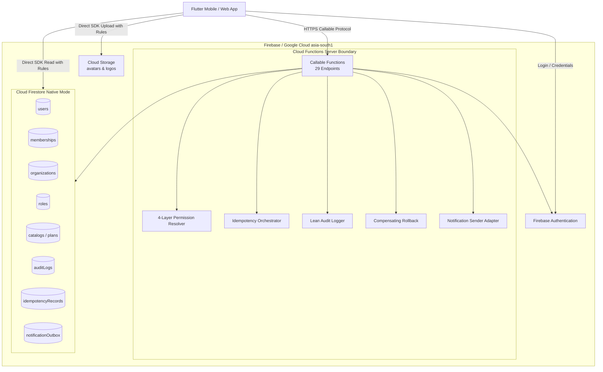
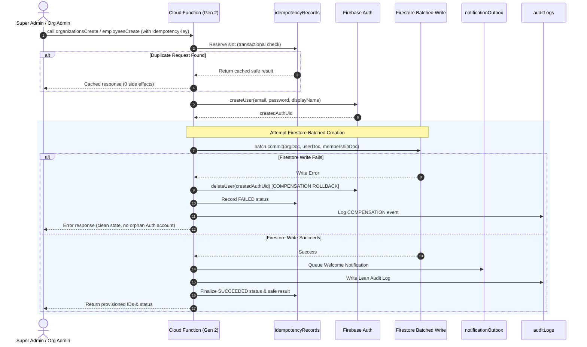

# Phase 1 Platform Architecture & Data Flow

**Document Version**: 1.0.0  
**Project**: Trado Firebase Backend (Phase 1)

---

## 1. System Topology & Boundaries

---

## 2. Multi-Tenancy Isolation Architecture

1. **Server-Side Enforcement**:
   - Multi-tenant isolation is never left to client-supplied tenant IDs.
   - For all tenant-scoped callables (`employees.*`, `roles.*`, `teams.*`, etc.), the server verifies the caller's membership in the target organization by querying `memberships/{callerUid}_{targetOrgId}`.
2. **Firestore Security Rules Perimeter**:
   - All direct client writes (`set`, `update`, `delete`) to Firestore are globally denied (`allow write: if false;`).
   - Client reads are strictly bounded:
     - A user may only read organizations where an active membership document `memberships/{request.auth.uid}_{orgId}` exists.
     - Cross-tenant queries are blocked.
     - Internal operational records (`auditLogs`, `idempotencyRecords`, `notificationOutbox`) deny all client reads and writes.

---

## 3. Provisioning & Two-Phase Compensation Flow

Because Firebase Auth and Cloud Firestore cannot participate in a single distributed ACID transaction, user provisioning utilizes a compensating rollback pattern:

---

## 4. Push Notification Foundation & Outbox Flow

1. **Local Isolation**:
   - Firebase Local Emulator Suite does not emulate APNs or live mobile FCM delivery.
   - A pluggable `NotificationSender` interface is used with a `MockNotificationSender` in emulator tests to ensure zero unexpected network calls or credential requirements.
2. **Delayed Welcome Dispatch**:
   - When an employee is provisioned, their mobile device token does not yet exist.
   - A pending record is placed in `notificationOutbox/{id}`.
   - Upon initial sign-in, the employee's client invokes `notificationsRegisterFcmToken` with their device hardware ID and FCM token.
   - The server stores the token at `users/{uid}/devices/{deviceId}`, inspects the outbox for pending welcome notifications for that user, dispatches them exactly once through the sender adapter, and marks the outbox status as `dispatched`.

---

## 5. Explicit Scope Boundaries (Phase 2 & 3 Non-Scope)

To maintain platform stability, Phase 1 code does **not** implement:
- **Phase 2 Exclusions**: POS sales register engine, B2B wholesale orders, purchases, expenses, inventory movements/stock adjustments, vendor/customer CRM, returns, delivery dispatcher, and country tax calculations.
- **Phase 3 Exclusions**: Executive reports/analytics dashboards, tasks, live location tracking, offline sync hardening, and cross-collection integrity auditing.

