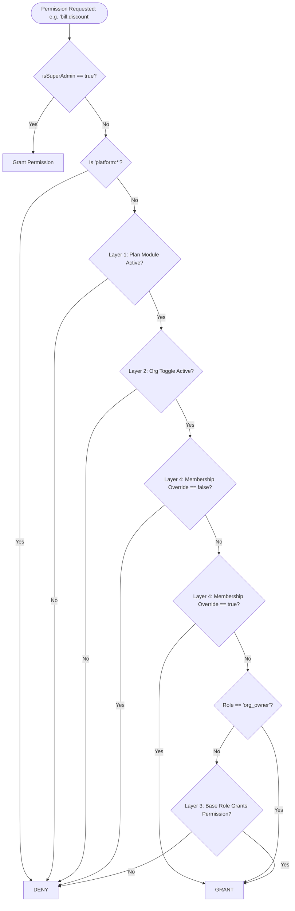

# Phase 1 Authentication & Four-Layer Permission Architecture

**Document Version**: 1.0.0  
**Project**: Trado Firebase Backend (Phase 1)

---

## 1. Authentication Foundation

### 1.1 Sign-in Method & Identity Provider
- **Primary Mechanism**: Firebase Authentication Email and Password, directly matching the Flutter mobile client sign-in workflow.
- **Phone OTP Provider**: Native Firebase Phone Authentication is the standard path. In Phase 1 emulator development, phone authentication is emulated via the Firebase Auth Emulator (`127.0.0.1:9099`). Real SMS routing and production verification require registering SHA-256 fingerprints and configuring SMS quotas in the Google Cloud / Firebase console.
- **Credential Storage**: Handled entirely by Firebase Authentication. No passwords, hashes, or credentials are saved in Firestore.
- **Password Reset & Verification**: Built-in Firebase Authentication email verification and password reset APIs (`sendPasswordResetEmail`) are utilized directly.

### 1.2 Custom Claims Strategy
Custom claims on the Firebase Auth ID Token are kept strictly minimal to prevent token bloat (1000-byte Firebase limit) and stale authorization vulnerabilities:
- `isSuperAdmin: boolean` (Platform operator bypass; set only by trusted Admin SDK server tooling).
- `primaryOrganizationId: string` (Optional UI convenience; never trusted alone for authorization).
- **Security Invariant**: Permission arrays, lists of organizations, or mutable role maps are **never** stored in custom claims. Every organization-scoped mutation resolves authorization server-side against the authoritative Firestore membership record.

### 1.3 Client Bootstrap Sequence
1. Client logs in with Firebase Authentication (`signInWithEmailAndPassword` or Phone Auth).
2. Client receives Firebase ID Token.
3. Client immediately calls `authMe` (`asia-south1-authMe`) callable.
4. Server extracts `request.auth.uid`, validates `users/{uid}.isActive === true`, queries all active memberships, loads active organization context, resolves effective permissions, and returns the session payload.

### 1.4 Client-Side Token Refresh Requirement
Firebase ID tokens cache custom claims in the signed client JWT for up to 1 hour. When custom claims are set or modified on the server (e.g. after initial organization provisioning sets `primaryOrganizationId`, or after changing primary tenant context), the client MUST force token refresh before claims take effect in Firestore security rules or callables:
- **Flutter**:
  ```dart
  await FirebaseAuth.instance.currentUser?.getIdToken(true);
  ```
- **Web**:
  ```typescript
  await auth.currentUser?.getIdToken(true);
  ```
Without forcing a token refresh, subsequent Firestore reads will carry the stale token missing the newly set `primaryOrganizationId`.

---

## 2. Four-Layer Permission Resolution Engine

The permission resolution engine evaluates capabilities through four cascading layers in strict precedence order:



### 2.1 The Four Layers Explained

#### Layer 1: Subscription Plan Modules (`subscriptionPlans/{planId}.moduleFlags`)
- Defines what modules the tenant is entitled to consume under their billing tier.
- If a module is `false` or missing in `moduleFlags` (e.g. `sales: false` on the Starter plan), **all** permissions belonging to that module domain are denied organization-wide.

#### Layer 2: Organization Module Toggles (`organizations/{orgId}.moduleToggles`)
- Tenant administrators can toggle modules on or off for their staff.
- Invariant: A tenant administrator cannot enable a module that is disabled by Layer 1 (Plan).
- If a module is toggled `false` in `moduleToggles`, all permissions belonging to that module domain are denied.

#### Layer 3: Base Role Permissions (`roles/{roleId}.permissions`)
- The base set of permissions granted by virtue of the user's assigned role (e.g. `cashier`, `manager`, `accountant`, `admin`).
- Expressed as an array of permission catalog codes. Supports universal wildcard `*` and prefix wildcards `namespace:*` (e.g. `report:*`).

#### Layer 4: Membership Overrides (`memberships/{membershipId}.permissions`)
- Fine-grained per-employee adjustments made by tenant managers.
- Stored as a key-value map: `{ [permissionCode: string]: boolean }`.
- **Strict Deny Precedence**: If an override is set to `false`, it strictly supersedes any role grant from Layer 3.
- If set to `true`, it grants that specific permission (provided Layer 1 and Layer 2 have not disabled the parent module).

---

## 3. Exceptions & Fail-Closed Rules

1. **Super Admin**:
   - `request.auth.token.isSuperAdmin === true` bypasses tenant module and role checks to allow platform administration and emergency support.
2. **Organization Owner**:
   - Role code `org_owner` has all capabilities within active tenant modules (excluding `platform:*`).
3. **Missing / Inactive References**:
   - If an organization is `inactive`, or if the user's membership is `inactive` or `suspended`, all permission checks fail closed (`return false` / HTTP 403).
   - If a referenced role or plan document cannot be found, resolution fails closed.

---

## 4. System Roles Hierarchy & Default Assignment

### 4.1 System Roles vs Job Roles Distinction
To maintain clean separation between permission authorization and operational job cataloging, Trado defines exactly three seeded system roles:
1. **`role_org_owner` (Organization Owner)**:
   - Full tenant authority. Automatically grants all permissions across all active modules (`*`).
2. **`role_admin` (Administrator)**:
   - Operational administration. Grants management permissions for staff, departments, jobs, teams, operational billing, purchases, and expenses.
3. **`role_employee` (Standard Employee)**:
   - Baseline system role tier with minimal default read access (`org:view`, `employee:view`).
   - Serves as the canonical fallback role when creating employees via `employeesCreate` without an explicit `roleId`.

Operational roles (`role_cashier`, `role_inventory_clerk`) are classified as **Job Roles** (`jobRoles` collection) or starter custom-role templates (`STARTER_CUSTOM_ROLE_TEMPLATES`), separating organizational titles and duties from security permissions.

---

## 5. Idempotency Lease-Expiry Recovery

To guarantee fault tolerance during network interruptions or worker timeouts, idempotency keys support lease-expiry recovery:
- When an operation begins, an idempotency record is transactionally created with `status: PROCESSING` and a short-lived lease deadline (`processingExpiresAt`, default 30 seconds).
- If the worker crashes or times out before updating the record to `SUCCEEDED`, subsequent requests within the lease window receive `ALREADY_EXISTS` ("Operation in progress").
- Once `now() >= processingExpiresAt`, the lease expires. Subsequent retry requests detect the expired lease and invoke an optional `recoveryChecker` to verify whether prior side-effects actually succeeded.
- If side-effects completed, the record self-heals to `SUCCEEDED` and returns the cached result. If side-effects never occurred, the transaction grants a new lease, safely re-attempting the operation without permanent lockout.


