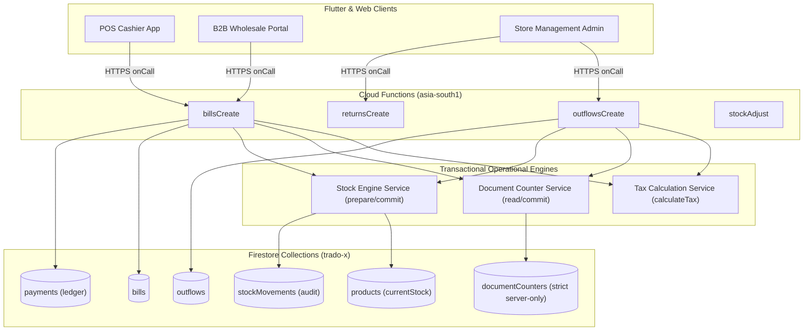
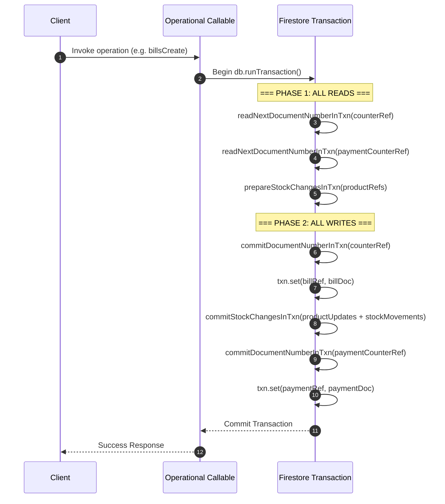

# Trado Firebase Backend — Phase 2 Architecture

## 1. System Overview

Phase 2 establishes the high-throughput operational core of the Trado multi-tenant platform. It integrates catalog management, transactional inventory movement, deterministic tax calculation, gap-free document numbering, and financial ledgering into a unified serverless architecture on Firebase Cloud Functions and Firestore.

---

## 2. Two-Phase Transactional Execution Pattern

Firestore transactions require that **all read operations (`txn.get()`) must precede all write operations (`txn.set()`, `txn.update()`, `txn.delete()`)**. Violating this order results in transaction aborts.

To guarantee zero transaction collision errors, every operational callable implements strict two-phase execution:

---

## 3. Core Operational Subsystems

### 3.1 Sequential Numbering Architecture (`documentCounters`)
- **Isolation**: Document sequences are partitioned by `organizationId`, `type` (`INV`, `POS`, `PUR`, `EXP`, `PAY`, `RET`, `DEL`, `ADJ`), and calendar/financial year (`YYYY`).
- **Counter Key**: `${organizationId}_${type}_${year}`.
- **Guarantee**: Monotonically incrementing integers formatted with zero padding (e.g., `POS-2026-000001`). Gap-free within committed transactions.
- **Security**: Directly inaccessible to client SDKs (`allow read, write: if false`).

### 3.2 Stock Engine (Read Strategy Option a)
- **Real-Time State**: Every product document maintains an immediate `currentStock` number.
- **Audit Ledger**: Every stock change appends an immutable document to `stockMovements` capturing `previousStock`, signed `quantity`, `balanceAfter`, and `referenceId`.
- **Precondition Safety**: If `trackStock` is enabled and `currentStock + delta < 0`, the transaction throws `failed-precondition`, blocking overselling.

### 3.3 Unified Outflows Model
- Consolidates purchases and operational expenses into `outflows`.
- `kind: "purchase"` lines with `addToStock: true` trigger automatic inventory receipt in `stockMovements` and `products.currentStock`.
- `kind: "expense"` lines represent operational overhead without inventory mutation.
- When `paidAmount > 0`, an atomic payment voucher is ledgered in `payments` under direction `"out"`.

### 3.4 Shared Sales & Billing Engine
- Unified core handling both walk-in retail POS sales and structured wholesale B2B invoices.
- Point-of-Sale: Walk-in customers (`customerSnapshot`), instant payment (`paidAmount = totalAmount`), `POS-` prefix.
- B2B Wholesale: Formal customer reference (`customerId`), credit terms (`dueDate`, `balanceAmount`), `INV-` prefix.

### 3.5 Deterministic Tax Engine
- Computes multi-jurisdictional tax breakdowns and freezes them into an immutable `TaxSnapshot` on every bill and outflow:
  - **India GST**: Splits into `CGST` + `SGST` for intra-state or `IGST` for inter-state based on state code matching.
  - **UAE VAT**: Standard 5% rate with TRN registration snapshot.
  - **US Sales Tax**: State-level single line tax rate.
  - **Exempt / None**: Zero-tax "Bill of Supply".

### 3.6 Quotations & Bill Finalization Lifecycle
- **Quotation Isolation**: Draft bills and quotations (`documentType: "quotation" | "proforma"`, `status: "draft"`) receive `QTN-` prefixes, do NOT decrement physical stock, and do NOT accept tender payments.
- **Conversion to Active Invoice**: Calling `billsFinalize` atomically checks real-time inventory sufficiency, decrements `currentStock`, logs `stockMovements`, commits an official `INV-` number, and creates the payment receipt if paid.

### 3.7 Decimal-Safe Money Service (`functions/src/services/money.ts`)
- Implements exact commercial half-away-from-zero rounding using `Number.EPSILON`.
- Supports ISO 4217 minor unit exponents across 3-decimal currencies (`BHD`, `KWD`, `OMR`), 0-decimal currencies (`JPY`, `KRW`), and 2-decimal currencies (`INR`, `USD`, `EUR`, `AED`).
- Guarantees exact fractional quantity precision (e.g., 4-decimal kg/liters) with zero floating-point accumulation drift.

### 3.8 Concurrent Barcode Locking (`barcodeLocks`)
- Enforces tenant-wide barcode uniqueness using deterministic lock documents `barcodeLocks/${organizationId}_${barcode}`.
- Evaluated inside the product creation and update transactions before document writes occur, eliminating race conditions under concurrent requests.
- Secured against direct client access (`allow read, write: if false`).

### 3.9 Ledger & Stock Reconciliation Engine (`functions/src/services/reconciliation.ts`)
- Provides on-demand and scheduled verification of database integrity:
  - **Stock Reconciliation**: Sums signed `quantity` across all historical `stockMovements` for each product and compares against `product.currentStock`. Reports discrepancies and provides atomic transactional repair.
  - **Party Ledger Reconciliation**: Recomputes customer receivables and vendor payables against bills, outflows, and payments, ensuring financial statements match transactional records.

---

## 4. Anti-Embedding Architecture Verification

In accordance with strict relational discipline, all Phase 2 collections adhere to lean reference design:

| Parent Entity | Referenced Entity | Architecture Rule Enforced |
| :--- | :--- | :--- |
| `deliveries` | `bills` | References `billId` by ID only. Never embeds the bill document or items. |
| `payments` | `bills` / `outflows` | References `referenceId` by ID only. Standalone financial ledger. |
| `stockMovements` | `bills` / `outflows` / `returns` | References `referenceId` by ID only. Standalone movement ledger. |
| `bills.items` | `products` | Snapshots display strings only (`nameSnapshot`, `priceSnapshot`, `costSnapshot`, `taxCodeSnapshot`). Never embeds entire product object. |
| `returns` | `bills` / `outflows` | References `referenceId` by ID only. Never embeds original invoice. |

This discipline is statically enforced and verified by `scripts/check-duplicate-embedding.js`.

